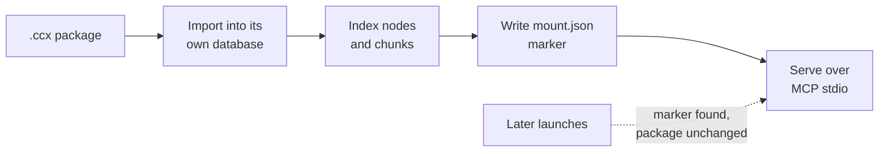

Your vault is the best-organised thing you own and your coding assistant cannot see a word of it. Every time you need the decision you wrote down in March, you go find the note, copy it, and paste it into a chat window — which is a strange way to use a second brain.

This walkthrough closes that loop. Fifteen minutes of hands-on work turns a folder of notes into a knowledge graph, packs that graph into a single file, and hands the file to your assistant so it is simply *there* on every launch.

<!-- truncate -->

## What you'll have at the end

- A knowledge graph built from your notes — entities and relationships pulled out of the prose, not out of the links you typed by hand
- One `vault.ccx` file containing that graph **plus the source text, chunks and citations** it came from
- Claude Code answering questions across the whole vault, with each answer traceable back to the note it came from
- A file you can copy to another machine, or hand to someone else, and it works there too

The *why* behind the graph layer is the subject of an [earlier post](/blog/obsidian-to-knowledge-graph) — the short version is that your vault knows more than its graph view shows, because the connections you never typed are still sitting in the prose. This post is the *how-to*, and it ends with the knowledge leaving the machine that built it.

## Before you start

You need two things running.

**The app**, as the published image:

```bash
docker run -d --name chaoscypher \
  -p 80:80 \
  -p 443:443 \
  -v chaoscypher-data:/data \
  --add-host=host.docker.internal:host-gateway \
  ghcr.io/chaoscypherinc/chaoscypher:latest
```

**The CLI**, which is what mounts the finished package into your assistant:

```bash
pip install chaoscypher-cli
```

The CLI is a separate install on purpose: the mount runs on your machine, next to the assistant, not inside the container.

## Step 1 — Zip the notes (2 minutes)

There is no folder picker. Chaos Cypher takes a **`.zip` or `.tar.gz` archive** of your notes, and that is also the path you want, because archives get better treatment than loose files:

```bash
cd ~/Documents
zip -r vault.zip MyVault
```

Two things decide whether this goes well:

- **Bundle at least ten `.md` files.** The archive loader scores what it finds, and the Markdown handler — the one that strips YAML and TOML front matter and keeps your heading structure — only engages at ten or more Markdown files. Under that threshold the generic handler takes over and your `---` front-matter blocks get indexed as if they were prose.
- **Start with a focused subfolder, not the whole vault.** Project notes, research, meeting notes — pick the slice you actually want to ask questions about. Private notes you would rather not send through an LLM should stay out of the zip.

Your `.obsidian/` folder needs no special handling: hidden directories are skipped automatically, so the workspace and plugin config never reach the graph.

Wikilinks are left exactly as they are. Nothing rewrites `[[Project Phoenix]]` into anything else — it stays in the text, the extractor reads it as prose like any other mention, and your deliberate links stay yours.

*In plain terms: zip at least ten notes from one folder, and the app will read them as Markdown rather than as raw text.*

## Step 2 — Upload it (1 minute)

Open the app at `http://localhost`, go to **Sources**, and click **Add Source**. Drop `vault.zip` into the dialog.


The helper line under the drop zone lists documents, data and media and does not mention archives — ignore it, the picker accepts `.zip`, `.tar.gz` and `.tgz` just fine.

Indexing runs first and takes seconds: your notes are chunked and embedded locally, which is enough to make the vault searchable. Then Chaos Cypher proposes an extraction domain for the notes it just read — confirm it (or override it) and extraction starts.

This is the step that is not 15 minutes. Indexing is quick; extraction is an LLM reading every chunk of every note, and how long it takes depends on your model and how much you zipped. Leave it running — the rest of this post is waiting on it anyway.

## Step 3 — Watch the graph form (while extraction runs)

Open the **Graph** page. Entities appear clustered around the notes that mention them, colour-coded by type.


The large hubs are your source notes; the coloured nodes around them are people, projects, concepts and organisations pulled out of the sentences. The lines between clusters are the interesting part — those are entities two different notes both talk about, which is precisely the connection a vault's own graph view cannot show you.

Worth doing before you export: ask the built-in chat something you already know the answer to. It is the cheapest way to find out whether the extraction actually understood your notes.


The chips in that answer link to entities in the graph — they are navigation, not source citations. The citations are what travel in the next step.

*In plain terms: the graph is the layer of connections your notes imply but never spell out, and a quick chat tells you whether it got them right.*

## Step 4 — Export the package (1 minute)

Go to **Settings** → **General** → **Import & Export** and click **Export**.


One gotcha that will stop you on the first try: **the export needs a Package Name**, set under the same **Import & Export** section in **Export Defaults**. Set it before you click Export.

Choose what to include — templates, knowledge, workflows, sources. Leave **sources** on: that is what carries the document metadata, chunks and citations, and without it your assistant's answers lose the thread back to the note. Leave embeddings off unless the machine you are mounting on uses the same embedding model.

Your browser downloads a single `.ccx` file. That one file is the whole thing.

## Step 5 — Mount it into Claude Code (1 minute)

```bash
claude mcp add vault -- chaoscypher mount /home/you/Downloads/vault.ccx
```

Use the **absolute path**. The command resolves a local package relative to the working directory it is launched in, and an MCP host's working directory is not the one you typed the command in — a relative `./vault.ccx` will not be found.

The first launch imports the package into a database of its own and indexes it, which takes a few seconds. Every launch after that finds the package unchanged and goes straight to serving, so the import cost is paid once rather than every time your assistant starts.

Two things worth knowing: the mounted package lands in the **CLI's** own data directory, not in the container's volume — they are separate stores, and that is the point, since the package is meant to be portable. And mounting needs no chat or extraction model configured at all; a fresh `pip install` can mount before it is ever set up. Configure an embedding model when you want semantic search rather than keyword search alone.

Mounting is not the same as loading a package into the graph you are working in — [the CLI reference](/docs/reference/cli/mount) has the comparison table.

*In plain terms: one command, pointed at the file with its full path, and your assistant has the vault from then on.*

## Step 6 — Ask it something your notes can answer

Start Claude Code in any project and ask a question that spans several notes:

```
> Across my vault, what led to the decision to drop the queue rewrite?
```

The assistant calls `graphrag_search`, which walks the graph and searches the chunks together, and answers from your notes — with the sentences it used, and the notes they came from, attached. Ask it to show its sources and it will point at the actual note, because the chunks and citations travelled inside the package.

The mount serves 21 read tools by default — search, traversal, shortest path, node context — and read-only is the default, so an assistant can explore the vault but never write to it.

## Under the hood

A mount is four steps the single command does for you:



The marker file is the reason re-launching is instant: it records the package's SHA-256 and the archive path, and it is only written once *both* the import and the indexing have succeeded. If indexing fails — the embedding model could not download, say — no marker is written and the next launch retries rather than serving a half-indexed package. Re-importing the same package never duplicates anything, because CCX import upserts by stable IRI.

Everything the command prints goes to stderr; stdout is the MCP JSON-RPC channel and stays clean from the first byte.

*In plain terms: the command is slow once and instant forever after, and it refuses to pretend it succeeded when it didn't.*

## Try it yourself

```bash
# 1. The app
docker run -d --name chaoscypher \
  -p 80:80 -p 443:443 \
  -v chaoscypher-data:/data \
  --add-host=host.docker.internal:host-gateway \
  ghcr.io/chaoscypherinc/chaoscypher:latest

# 2. Ten or more notes, zipped
zip -r vault.zip ~/Documents/MyVault/Projects

# 3. Upload at http://localhost → Sources → Add Source
#    Confirm the extraction domain, let it run

# 4. Settings → General → Import & Export → Export
#    (set a Package Name in Export Defaults first)

# 5. Mount the downloaded package
pip install chaoscypher-cli
claude mcp add vault -- chaoscypher mount /absolute/path/to/vault.ccx
```

## What's next

The same `.ccx` works anywhere the CLI runs. Copy it to your laptop and mount it there. Put the mount command in Claude Desktop's or Cursor's config instead and the vault shows up in those too. Hand the file to a colleague and they get the graph, the notes and the citations — no re-extraction, no re-linking, and no account.

If you would rather have the knowledge merged into a graph you are already building on instead of served from one of its own, that is `chaoscypher graph package load` — same file, different destination.

<!-- optional screenshot: Claude Code session answering a multi-hop vault question with the mounted package, showing the cited note filenames -->
