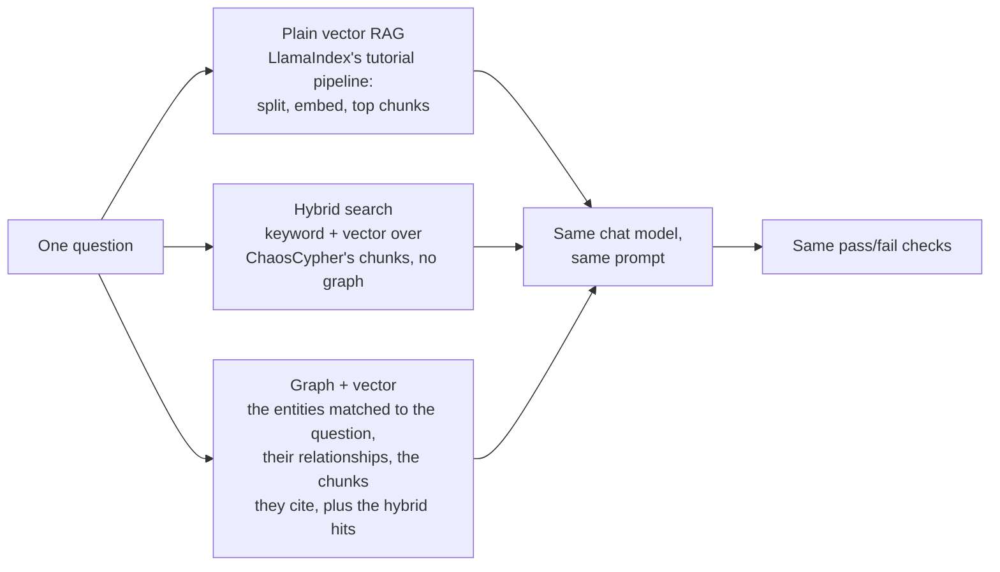

If you run RAG over your own documents with a local model, you have seen this answer: polite, well-written, and missing part of what you asked. The question needed two facts from two different chapters, or the link between two people who never appear in the same paragraph, and the retriever handed the model four chunks that sounded like the question instead.

That is the problem a knowledge graph is supposed to fix. We wanted a number for how much it does, measured on models you can run at home, against a baseline we did not write. So we asked 22 local models the same questions three ways and put every row on the [leaderboard](/leaderboard).

<!-- truncate -->

## The short version

The board states three headlines, each one only because it held across the models measured:

- **33% fewer failed answers than plain vector RAG on ordinary questions** (fewer on 22 of 22 models; failed answers 19% → 13%). These are the 80 original questions, which were not written with the graph in mind.
- **50% fewer failed answers on graph-shaped questions than plain RAG** (median over 22 models; 18 of 22 remove at least 25% against plain RAG and against hybrid search).
- **Llama 3.1 8B with the graph answers as well as Qwen3.6 27B, the top-scoring model on plain vector RAG** (86% vs 86% on ordinary questions), which needs 3.7× the GPU memory of the 8B; 15 of 22 models match it with the graph.

Each headline is judged over all 22 models, not on whichever model came out on top. The [leaderboard](/leaderboard) shows each one with every model's row behind it.

In plain English: compared with plain vector RAG, adding the graph cut the answers that failed on every model we ran, and it let a small model answer about as well as a much bigger model running plain vector RAG.

## How the comparison works

Every model gets the same question, the same prompt and the same answer checks three times. The only thing that changes is what the retriever puts in front of it:



The plain-RAG rung is LlamaIndex's standard tutorial pipeline, run through LlamaIndex itself rather than code of ours, because a baseline we wrote would be too easy to weaken by accident. The hybrid rung is our own keyword + vector search with the graph switched off, so you can see what the graph adds on top of a good search, not only on top of a simple one. The chunk budgets are matched, so the comparison is about what each rung retrieves, not how much.

What the graph rung adds is lines like the one below: a relationship between two named people, with the justification the extraction model wrote for it from a cited sentence.


In plain English: three retrievals, one model, one set of checks, so any difference in the answers comes from what the model was shown.

## What counts as a failed answer

An answer passes only if it names what the question asked, names nothing the retrieved context does not hold, and declines when the book does not answer the question. Anything else is a failed answer.

We say "failed", not "wrong", on purpose. Most of the misses the graph removes are answers that left out part of what was asked, or that declined when the context did hold the answer. Wrong facts stated are a small share of the misses under every rung.

In plain English: the graph mostly helps the model give the complete answer instead of half of it, or instead of giving up.

## Under the hood

**The questions.** The corpus is Book One of *War and Peace*. Each model answers the 80 original questions (single facts, paraphrases, multi-hop joins, look-alike names, and questions the book does not answer), plus a band of graph-shaped questions written in advance in four kinds: joins across chapters, how two people are connected, which people share a scene or a trait, and two people the text keeps apart by a shared name or title. *War and Peace* is good at that last one: two Annas, two Princes Bolkónski, the Kurágin brothers.

**The keep rule.** It was fixed before any model ran: a graph-shaped question is dropped only when no rung retrieves its answer, never because a baseline wins it. Every kept question counts under every rung, including the ones plain RAG wins.

**The bars.** A headline appears on the board only when the exporter finds it holds across the models measured, never on one or two of them, and only on a board that was not let through with an override. "Fewer failed answers on ordinary questions" needs the median to clear 25% and most models to clear it too. The graph-shaped headline has to clear the same bar against plain RAG and against hybrid search. The size headline needs most models to reach the bigger model's score with the graph. A fourth candidate headline, questions only the graph rung answers, did not clear its bar this time, so the board does not state it.

**The receipts.** Every model's run is archived with its raw answers, and the scorer can be re-applied to a saved run without touching the models. When a check is fixed, the board is rescored from those answers, not re-run, and the board records which scorer produced it. The [leaderboard](/leaderboard) also carries worked examples: for a graph-shaped question, each rung's retrieved context, the model's answer and its verdict, with nothing hand-edited.

The full method, with every check, is on the [methods page](/docs/reference/extraction-benchmark#where-the-graph-matters-the-three-rung-retrieval-comparison).

In plain English: the questions and the rules were set before the runs, a headline has to hold for most models before it is printed, and every answer is kept so the scoring can be checked again.

## Where this result stops

We would rather you know the limits before you quote the numbers.

- **One corpus, and it is a novel.** Fiction is full of people, families and look-alike names, which may be where a graph helps most. A second corpus, technical documentation, is next, and these figures say nothing about it until it is measured.
- **Local models only.** All 22 are open-weight models pulled from Ollama. The board says nothing about hosted models on this comparison.
- **Measured on the board's day.** The figures are for the board dated 2026-10-21 and the build it measured. The graph + vector search measured there is on our main branch; the image you can pull today carries an earlier version of the same search.
- **Two headlines are against plain RAG only.** The ordinary-question figure and the small-model match are against plain vector RAG. On Book One, against hybrid search the ordinary-question gain is smaller (median 24%, and 11 of 22 models remove at least 25% of their failed answers, one short of a majority), so we claim neither against hybrid search.
- **The graph is not free.** The extra context also makes some models answer out-of-scope questions they should decline. That one is on our list.

In plain English: this is one book, local models, one day's build, and a clear list of what it does not show.

## Try it yourself

The graph + vector search is what ChaosCypher's chat uses, and it runs on your machine with Ollama. Start the published image:

```bash
docker run -d --name chaoscypher \
  -p 80:80 \
  -p 443:443 \
  -v chaoscypher-data:/data \
  --add-host=host.docker.internal:host-gateway \
  ghcr.io/chaoscypherinc/chaoscypher:latest
```

Then:

1. Open [http://localhost](http://localhost), create your account, and point the setup at your Ollama.
2. Upload a document with a cast: a novel, a long report, a set of meeting notes.
3. Ask a question that joins two facts from different parts of it, or asks how two people are connected.
4. Open the citations and the graph. The entities and relationships behind the answer are there to inspect, each with the sentence it came from.


The [quickstart](/docs/getting-started/quickstart) walks through each step. Nothing leaves your machine unless you choose.

To read the comparison itself, open the [leaderboard](/leaderboard) and scroll to "Where the graph matters": every model's counts under each rung, the lift with its interval, and the worked examples. How the runs are made is on the [methods page](/docs/reference/extraction-benchmark#where-the-graph-matters-the-three-rung-retrieval-comparison).

## What's next

The second corpus is technical documentation, a different shape: fewer people with shared names, more terms that mean different things in different sections. If graph + vector helps there too, it will show up on the same board, held to the same bars. If it does not, that will show up too.

In the meantime, we plan to give every new model on the leaderboard the same three-way run. If you want a model on it, open a discussion on GitHub and tell us which one.
