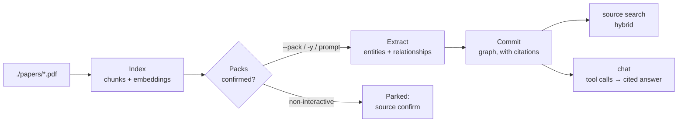

You have a folder of papers. You want to ask it a question and get an answer that tells you which paper, and which sentence, it came from. You do not want to open a browser, start a container or paste anything into a hosted chat window.

This walkthrough does all of it from one terminal: install, point at a local model, ingest the folder, search it, and ask. Every command below can be copied and pasted as written.

<!-- truncate -->

## What you'll have at the end

- Every PDF in the folder turned into searchable text **and** a knowledge graph of the people, methods, datasets and ideas the papers talk about
- A one-line search that returns both entities and passages
- A chat answer that prints the supporting sentence and the filename under each claim, in your terminal
- One command away from a portable `.ccx` file you can mount into an AI assistant

Everything runs on your machine. The documents, the graph and the model calls stay local when you use Ollama.

## Before you start

You need two things:

- **Python 3.14** and [pipx](https://pipx.pypa.io/)
- **[Ollama](https://ollama.com/)** running locally (`ollama serve`, or the desktop app)

Install the CLI:

```bash
pipx install chaoscypher-cli
```

If 3.14 is not your default interpreter, tell pipx which one to use:

```bash
pipx install --python python3.14 chaoscypher-cli
```

Check it landed:

```bash
chaoscypher --help
```

The CLI is a complete install, not a client for a server. It keeps its own database under your user data directory, so nothing else has to be running.

## Step 1 — Point it at Ollama (2 minutes)

```bash
chaoscypher setup --provider ollama
```

The wizard asks how much VRAM your GPU has and picks a matching preset of chat and extraction models, then tests the connection to Ollama at `http://localhost:11434`. When it finishes it prints a **Configuration Complete** panel listing the **Chat Model** and **Extraction Model** it chose.

Setup does not download models. Pull the two it names:

```bash
ollama pull <chat model from the panel>
ollama pull <extraction model from the panel>
```

Then confirm everything is reachable:

```bash
chaoscypher health
```

Embeddings need no extra step: by default they are generated on the CPU by a local sentence-transformers model, with no API key and no Ollama model involved.

Setup is not optional. On a fresh install, any command that would need a model — `source add`, `chat` — stops and offers to run the wizard first; in a script or CI job it exits with a message telling you to run `chaoscypher setup`. Doing it up front saves that detour.

*In plain terms: one command picks local models that fit your GPU, you pull them, and `health` tells you whether it all connects.*

## Step 2 — Feed it the folder (a few minutes of typing, then wait)

Put your PDFs in one folder and hand it over:

```bash
chaoscypher source add ./papers/ --pack scientific
```

A directory is expanded to every supported file directly inside it (sub-folders are not walked). A shell glob works too: `chaoscypher source add ./papers/*.pdf --pack scientific`.

Each file goes through four stages in the foreground — upload, index, extract, commit — with a spinner per stage:

- **Index** splits the text into chunks and embeds them. After this stage a paper is already searchable.
- **Extract** is the model reading every chunk and pulling out entities and relationships. This is the slow part, and how slow depends entirely on your model, your GPU and how many pages you gave it.
- **Commit** writes those entities and relationships into the graph, each one linked back to the sentences it came from.

When there is more than one file, the run ends with a batch table: one row per file, its status and how long it took.

**Why `--pack scientific`.** Every source is extracted with a generic floor of core entity types, plus one or two *packs* that add domain vocabulary. By default the CLI detects the packs from the text and, in an interactive terminal, **stops to ask you to confirm them — once per file**. For a folder of papers that is a prompt per paper. Naming the pack yourself skips the question. If you would rather let detection choose per paper without asking, use `-y` instead:

```bash
chaoscypher source add ./papers/ -y
```

In a non-interactive shell, an unconfirmed source is not prompted for — it is parked as `awaiting_confirmation` and the CLI prints the `chaoscypher source confirm <ID>` command that resumes it.

*In plain terms: one command reads the whole folder, and naming the subject up front stops it from asking you about every file.*

## Step 3 — Check what landed

```bash
chaoscypher source list
```


Every file has a **Status** and, once extracted, a **Quality** score. `committed` means the file made it all the way into the graph.

If you stopped the run part-way — or a long extraction was interrupted — nothing is lost:

```bash
# Files that are not committed yet
chaoscypher source list --pending

# Pick one and carry on from the stage it reached
chaoscypher source add --resume
```

A resumed file skips the stages it already finished, so an extraction that completed is never billed to your GPU twice.

## Step 4 — Search it

```bash
chaoscypher source search "contrastive learning"
```


*(The screenshots in this post come from a sample database built from a novel rather than papers; the commands and output shape are the same.)*

The default mode is **hybrid**: keyword and vector search together. Results mix two kinds of hit — **entities** from the graph (with their type in the Template column) and **passages** from the text (shown as `chunk #N`). Use `--mode keyword` for exact terms, `--mode semantic` for meaning only, and `--format json` when you want to pipe the results somewhere else.

Search is the quick sanity check: if the names you expect show up as entities, extraction understood your papers.

## Step 5 — Ask it a question

```bash
chaoscypher chat "Which of these papers evaluate on the same benchmark, and do their results agree?"
```

Before the answer, the CLI prints each tool the model calls, as it calls it:

```text
  → search_nodes(query=benchmark)
  → get_node_edges(node_id=…)
  → search_chunks(query=evaluation results)
```

Then the answer streams in. Entity names are printed in bold, and every claim the model ties to a source is followed by **the sentence it rests on and the file that sentence came from**:

```text
Two of the papers report results on the same benchmark …

  │ <the exact sentence from the paper, quoted from the source text>
  └─ <the PDF's filename>
```

That quote is not the model paraphrasing. The model cites a chunk and sentence numbers; the CLI looks those up and prints the stored text of those sentences. If a citation cannot be resolved to stored text, you get the bare label instead of an invented quote. When you pipe the output to a file, the same block is written with plain `|` and `--` characters so it stays readable.

Drop the question to get an interactive session (`chaoscypher chat`), and narrow any question to specific papers with `-s <source-id>` (repeatable; the IDs are in `source list`).

The exact wording of the answer depends on your model and your papers. Shape is what to check: an answer with citations under it, each pointing at a file in your folder.

*In plain terms: you get an answer, and directly beneath each claim, the sentence from your PDFs that backs it and the file it lives in.*

## Under the hood



The chat is not one retrieval step followed by one generation step. The model is given tools — search nodes, search chunks, follow a node's edges, find a path between two nodes, GraphRAG search — and decides which to call, in a loop, until it can answer. That is why a question like "which papers share a benchmark" works: it needs the graph to connect papers through an entity they both mention, and the text to quote what each one says about it.

Chat tools run without asking by default. If you want to approve anything that would write to the graph, set `chaoscypher config set chat.tool_approval ask-on-write`; read-only tools still run on their own.

*In plain terms: the model searches your graph and your text the way you would, and the CLI only prints quotes it can find in the stored text.*

## Try it yourself

```bash
# 1. Install (Python 3.14)
pipx install chaoscypher-cli

# 2. Point at Ollama, then pull the two models the summary names
chaoscypher setup --provider ollama
chaoscypher health

# 3. Ingest the folder
chaoscypher source add ./papers/ --pack scientific

# 4. Check, search, ask
chaoscypher source list
chaoscypher source search "your topic"
chaoscypher chat "your question"
```

## What's next — take it with you

The graph you just built lives in the CLI's local database. One line packs it into a single file:

```bash
chaoscypher graph package export -o papers.ccx --title "My papers"
```

That `.ccx` carries the graph **and** the sources, chunks and citations, so answers stay traceable wherever it goes. Mount it into an AI assistant with the command from [Build it once, mount it anywhere](/blog/build-once-mount-anywhere):

```bash
claude mcp add papers -- chaoscypher mount /absolute/path/to/papers.ccx
```

Prefer to see the graph? The full app runs the same pipeline with a graph canvas and click-through citations, as the published image:

```bash
docker run -d --name chaoscypher \
  -p 80:80 \
  -p 443:443 \
  -v chaoscypher-data:/data \
  --add-host=host.docker.internal:host-gateway \
  ghcr.io/chaoscypherinc/chaoscypher:latest
```

Every command in this post is covered in more depth in the CLI reference: [sources](/docs/reference/cli/sources), [chat](/docs/reference/cli/chat), [mount](/docs/reference/cli/mount).

<!-- optional screenshot: terminal showing `chaoscypher chat` answering a question over a folder of papers, with the │ quoted sentence and └─ filename citation lines visible -->
