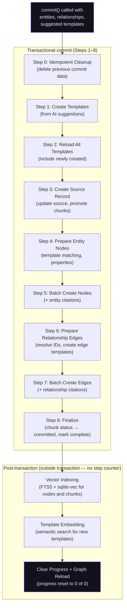
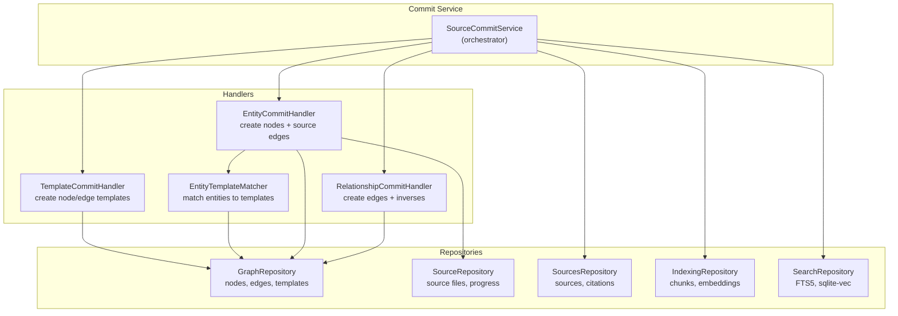

# Commit to Graph

The commit phase is the final stage of document source processing. It transforms deduplicated extraction results -- entities, relationships, and template suggestions -- into permanent graph structures: nodes, edges, and templates stored in the knowledge graph database.

Commit is orchestrated by `SourceCommitService`, which coordinates four specialized handlers:

| Handler | Responsibility |
|---------|---------------|
| `TemplateCommitHandler` | Create node templates from AI suggestions |
| `EntityTemplateMatcher` | Match entities to templates |
| `EntityCommitHandler` | Create entity nodes with source tracking |
| `RelationshipCommitHandler` | Create relationship edges with inverse generation |

## Commit Flow

The commit executes an 8-step transactional pipeline with progress reporting for UI display, followed by post-transaction work that runs after the database `COMMIT`:



Each transactional step updates a progress indicator (`step N of 8`) that the UI polls to show real-time commit status. Post-transaction work runs after the database commit and carries no step number.

Source provenance is tracked via entity properties (`source_document_id`, `source_document_name`) and `SourceCitation` records rather than separate graph nodes and edges.

## Orphan Entities: Keep, Flag, Never Delete

An **orphan** is an entity that survived deduplication but that no
relationship references. Before Step 0, `flag_orphan_entities()` decides
what happens to each one:

- An orphan that **carries evidence** — a description, or an evidence
  sentence it was cited in (`entity_cleaner.carries_evidence`) — is
  committed like any other entity, with the node property
  `properties.orphan: true`. Its description, aliases and citations are
  kept.
- An orphan that carries **neither** is dropped, unless the source's
  `protect_orphans` is on (the `minimal` and `unfiltered` presets, or the
  per-source override), in which case it too is committed flagged.

Until October 2026 the commit deleted every orphan whenever orphan
protection was off, description and all: 20 to 36 entities on a typical
novel-length source, among them people whose only fact was in their
description because the relationship pass happened not to write their
edge. The flag lets each consumer decide instead:

- **Chat retrieval** lets an orphan seed by name, by its written label or
  by vector like any named node, and ranks it after every connected
  entity of the same standing in the context and in the provenance lookup
  (`graphrag_handlers._by_standing`).
- **The graph canvas** links every flagged node to its "Unresolved (N)"
  node, which starts closed and shows or hides them on a double-click.
- **The identity resolver** treats an orphan as a normal node; when it
  merges an orphan into a connected node, the merged node is connected
  and loses the flag (it keeps the flag only when both nodes were
  orphans), and the descriptions are merged.

The flag is the commit's own: a connected entity loses a stale
`orphan: true`, and an extracted `orphan` property with any value other
than `true` (`"yes"`) is the text's and is left alone. The helper takes
the entity list and the relationship list (relationships are keyed by
integer indices into the entity list — no graph IDs exist yet at this
stage) and returns:

```python
class OrphanCommit(NamedTuple):
    entities: list[dict]       # input order, every kept orphan flagged
    relationships: list[dict]  # remapped onto the kept entities' positions
    flagged: int               # orphans kept with the flag
    dropped: int               # orphans dropped for carrying nothing


def flag_orphan_entities(
    entities: list[dict],
    relationships: list[dict],
    *,
    keep_evidence_less: bool,  # FilteringConfig.protect_orphans
) -> OrphanCommit: ...
```

`flagged` drives the `orphan_entities_filtered` quality counter (the
orphans **kept**, flagged — before October 2026 this counter held the
orphans deleted) and `dropped` drives `evidence_less_entities_dropped`.
The helper preserves input order and remaps surviving relationships to
the new index positions so downstream consumers (`commit/relation.py`,
`commit/service.py`) can keep using integer-indexed references.

## Pipeline Flags on Nodes and Edges

The orphan flag is one of several. Keep, flag, never delete (October 2026):
wherever the pipeline used to drop a record that carries evidence, it now
keeps it with a flag, a boolean property that is exactly `true` (an
extracted property of the text's under the same key, such as `"yes"` or
`"Niece"`, is never read as a flag). The commit stores each one with the
node or the edge.

| Flag | On | Written by | Means | Beside it |
|---|---|---|---|---|
| `orphan` | node | commit (`flag_orphan_entities`) | no relationship when its source was committed | |
| `descriptor_reference` | node | deduplication (`publish_descriptor_references`) | labelled by a reference, not a name: `the count`, `Prince Andrew's wife`, and of any type `the army`, `the village` | |
| `low_plausibility` | node | per-chunk plausibility filter | its name scored below the bar; kept because it carries evidence | `plausibility` (the score) |
| `unplaced_type` | node | per-chunk type rescue (and the commit and the CCX import, through `type_rescue.core_typed`) | no core type answers to the type the model wrote; kept as a `Concept` | `written_type` |
| `unevidenced` | node | per-chunk evidence filter (`sort_entities_by_evidence`) | the cited sentence does not name it; kept because it carries a description | `evidence_reason` |
| `excluded_name` | node | per-chunk exclusion filter (`filter_excluded_entities`) | its name is one of the domain's exclusion examples; kept because it carries evidence | `excluded_by` (the rule) |
| `capped` | edge | relationship caps (`enforce_relationship_limits`) | past the same-source-and-type, entity-degree or total cap | `cap_pass`, `cap` |
| `unevidenced` | edge | per-chunk evidence filter | no cited sentence states the relationship | `evidence_reason` |
| `unmatched_label` | edge | strict type check (`validate_relationship_type_constraints`) | no relationship type of the domain answers to the label the model wrote; kept as `related_to` | `written_label` |
| `type_mismatch` | edge | strict type check | its endpoints are not core types its relationship type allows (or fit only reversed, with direction correction off) | `type_mismatch_reason` |

The node flags are listed once in `name_identity.PIPELINE_FLAG_KEYS` and
in the interface's `NODE_FLAGS` table (`utils/nodeFlags.ts`); the edge
flags in `PIPELINE_EDGE_FLAG_KEYS` and `EDGE_FLAGS` (`utils/edgeFlags.ts`).
One cortex test pins that each pair lists the same keys, and that each edge
flag's detail (`EDGE_FLAG_DETAIL_KEYS`: the reason, or the label the model
wrote) is what the interface shows beside it. `unevidenced` is one key for
nodes and edges. Their consumers:

- **Chat retrieval** sorts candidates by `name_identity.node_standing`:
  a named connected node first, then an orphan, then a reference; within
  each, a node the pipeline doubted (`low_plausibility`, `unplaced_type`,
  `unevidenced`, `excluded_name`: `DOUBTFUL_NODE_FLAG_KEYS`) ranks last. PageRank walks a `capped` edge at a tenth of
  an edge's weight (`name_identity.edge_walk_weight`), so a hub's capped
  edges carry little of its mass; an `unevidenced` edge stays out of
  PageRank, the paths and the relationship lines unless
  `graphrag.include_unevidenced_edges` is on. The relationship lines are
  ranked in the same order (`name_identity.TripleStanding`) before the
  `max_triples` cap, and the triple summary's budget cuts the tail of that
  order: the endpoints' standing first, then evidenced before unevidenced,
  then an unflagged edge before a capped, unmatched-label or
  type-mismatched one.
- **The graph canvas** links every flagged node to its "Unresolved (N)"
  node and says why in the node's hover and detail panel, shows the flags
  as chips on the entity page, draws an unevidenced edge dashed and a capped, unmatched-label or
  type-mismatched one thin, and the edge detail names every flag an edge
  carries with the reason given (or the label the model wrote).
- **Merges** (the deduplication and the identity resolver) keep `orphan`,
  `low_plausibility`, `unplaced_type`, `unevidenced` and `excluded_name`
  only when every merged record carried them, and an edge flag only when
  every merged copy of the fact carried it (one rule,
  `deduplication.service.merge_unanimous_flags`); an edge flag's reason
  goes with it, while the written label stays; the reference flag is
  written from the final label.

## Idempotent Cleanup (Step 0)

Before creating any new graph data, a **re-commit** releases the source from the graph, in the commit's own transaction. This makes re-commit safe and idempotent -- if a commit fails partway through or a user re-commits a document, the source's previous contribution is taken out first.

The release does not delete by source ID: identity resolution may have merged this source's nodes with another source's. It:

- Removes the source's memberships (`graph_node_sources` / `graph_edge_sources`)
- Deletes the nodes and edges no other source attests, with their search index entries
- Rebuilds every node and edge another source still attests from the snapshots its remaining sources wrote, and re-homes it to one of them
- Deletes the source's templates nothing uses; one still in use goes to a source that attests one of its users
- Deletes the entity and relationship citations of the source
- Resets chunk status back to `"indexed"` for re-promotion

The commit then writes the source's rows again. Node and edge IDs are content-addressed, so a row that survived the release under another source gets the same ID back: the commit records the source's membership on it with what it writes now and rebuilds it from all its members, so the source's reading is part of the node again and a later delete of the other source keeps it. After the commit, identity resolution runs over the rebuilt nodes and the commit's nodes, and the nodes whose text changed are re-embedded.

A forced re-extract runs the same release when it resets the source. See [Knowledge Graph Storage](../graph-storage.md#provenance-membership-and-the-enabled-filter) for the membership model.

## Template Generation and Matching

### Template Creation (Steps 1-2)

During extraction, one **node template** is suggested per core type the entities carry (at most eight: "Person", "Organization", ...), with the floor's description, icon and colour; a pack subtype rides on the node as `properties.entity_subtype`, not as a template of its own. The commit phase creates these as actual graph templates. A suggestion named by an old per-type name (a payload cached before the core types: "Character") is created as its core type's ("Person"), once.

**Per-source isolation:** Each source gets its own templates. There is no cross-source template reuse. This ensures:

- Sources can be independently deleted without orphaning shared templates.
- Template definitions are scoped to the document's domain context.
- A source's release removes its templates once nothing uses them.

Templates with invalid names (`unknown`, `untitled`, `n/a`, `none`) are skipped. Each template includes:

- **Name:** The core type (e.g., "Person", "Location")
- **Description:** The floor's description of the core type
- **Properties:** List of `PropertyDefinition` objects (name, display name, type, required flag)
- **Source ID:** Links the template to its originating source

**Implementation:** `TemplateCommitHandler.create_suggested_templates()` in `commit/template.py`; each template is built by `template_from_suggestion()`, which the CCX import also uses for the core templates of a package from before the core types.

### Template Matching (Step 4)

When preparing entity nodes, each entity's type is matched to a template from the current source's templates using `EntityTemplateMatcher`:

1. **Exact match:** The entity's core type (`committed_type`: an old `Character` reads as Person), lowercased, is looked up in the `template_name_to_id` mapping built during template creation.
2. **Fallback:** If no match is found, the entity is assigned `system_template_item` (the default system node template).

The matcher uses a per-run cache keyed on `(entity_type, template_mapping_hash)` to avoid redundant lookups.

:::note[No cross-source matching]

The matcher intentionally ignores any `template_id` from the extraction phase because those could reference templates from other sources. Only templates created for the current source are considered.

:::

**Implementation:** `EntityTemplateMatcher.match()` in `commit/matcher.py`

## Node Creation (Steps 3-5)

### Source Record and Chunk Promotion (Step 3)

The source record is updated with commit-related fields (`total_content_length`, `enabled`). Chunks fetched in the prep phase are promoted from `"indexed"` to active status so they remain visible for RAG/search.

### Entity Node Preparation (Step 4)

For each entity in the extraction results, the commit handler:

1. **Places the type** with `type_rescue.core_typed`: `graph_nodes.entity_type` is the core type and the subtype goes to `properties.entity_subtype` when the entity carries none; a type no core type answers is stored as a `Concept` flagged `unplaced_type` (with `written_type`)
2. **Resolves the template** via `EntityTemplateMatcher`
3. **Loads pre-computed embeddings** from the extraction phase (stored by entity index)
4. **Builds properties:**
    - Copies extracted properties from the entity
    - Preserves lists for `aliases`, `nicknames`, `tags`, `also_known_as`, `descriptors` (useful for search)
    - Normalizes other list values to comma-separated strings
    - Ensures required properties exist for the matched template (e.g., `definition` for system_template_item, `title`/`content` if required by template)
    - Adds source tracking: `source_document_id`, `source_document_name`, `source_type`, `ingested_at`
5. **Creates a `NodeCreate` object** with label, core type, template ID, properties, embedding, and source ID

### Batch Node Creation (Step 5)

All prepared nodes are created in a single batch operation via `graph_repository.create_nodes_batch()` (with events suppressed for performance during import).

After creation, the handler:

1. **Builds index mappings:**
    - `entity_index_to_node_id` -- maps extraction entity index to the created graph node ID
    - `entity_name_to_node_id` -- maps entity name to node ID (for name-based relationship resolution)
    - `entity_index_to_node` -- maps to full Node objects (used for citation creation without redundant lookups)
2. **Creates entity citations** -- one citation per entity node linking it back to the source chunk it was extracted from (Step 5b)
3. **Queues nodes for search indexing** -- node FTS5/sqlite-vec indexing is deferred to the post-transaction phase to avoid self-deadlocking on the writer lock held by the transaction

**Implementation:** `EntityCommitHandler` in `commit/entity.py`

## Edge Creation (Steps 6-7)

### Edge Template Creation (Step 6)

Unique relationship types from the extraction results need edge templates. The handler:

1. Collects all unique edge type names (including inverse types from domain configuration)
2. Batch creates templates for all types via `graph_repository.create_templates_batch()`
3. Builds an `edge_type_to_template_id` mapping for edge creation

Edge template descriptions come from domain-aware `suggested_edge_templates` in the extraction results. If no description is available, the type name is title-cased (e.g., `"located_in"` becomes `"Located In"`).

Per-source isolation applies to edge templates too -- each source creates its own edge templates.

### Relationship Edge Preparation (Step 6 continued)

For each relationship, the handler:

1. **Resolves node IDs** from entity references:
    - **Index-based** (standard workflow): Uses `entity_index_to_node_id` to map `source`/`target` integer indices to node IDs
    - **Name-based** (NLP workflow): Uses `entity_name_to_node_id` to map `from`/`to` entity names to node IDs
    - Relationships with unresolvable references are skipped with a warning
2. **Looks up the edge template ID** from the pre-created mapping
3. **Builds edge properties** from the relationship metadata: `confidence`, `justification`, `sent_ref`, `chunk_index`, plus any custom properties (the evidence filter's `unevidenced` flag and `evidence_reason` among them: [A relationship without evidence is kept, flagged](entity-extraction.md#a-relationship-without-evidence-is-kept-flagged))
4. **Creates an `EdgeCreate` object** with template ID, source/target node IDs, label, properties, and source ID

### One Fact, One Edge

The stable-edge upsert stores one edge per `(template, source node, target
node)` and keeps the first copy's properties, so a fact the model wrote in
several chunks keeps one set of edge properties (every copy keeps its
justification on its own relationship citation). Before the upsert,
`fold_fact_copies` folds the copies through the one edge-merge policy
(`deduplication.service.merge_edge_properties`, which the identity
resolver's merge uses too): the edge is flagged `unevidenced` (or
`capped`) only when every copy is, and when the first copy is unevidenced and a later one is
evidenced, the evidenced copy's sentence (`justification`, `sent_ref`,
`chunk_index`) leads. Copies that agree leave the first edge as it was.

When the identity resolver merges two nodes and an edge of the dropped node
duplicates one the kept node already has, the duplicate is not deleted with
its text: its justification is appended to the kept edge's
`properties.justifications` (the kept edge's own first), under the same
policy (`resolution.apply._move_edges`; `ResolutionReport.edges_folded`).

### Inverse Edge Generation

For each relationship that has a domain-defined **inverse type** (e.g., `parent_of` has inverse `child_of`), an additional edge is automatically created with:

- **Swapped source and target** node IDs
- The inverse type's template ID
- Same confidence and justification as the original
- An `inverse_of` property set to the original edge type

Symmetric relationships (where the type equals its own inverse, e.g., `interacts_with`) do not generate inverse edges to avoid duplication.

### Batch Edge Creation (Step 7)

All edges (including inverse edges) are created in a single batch via `graph_repository.create_edges_batch()`.

**Implementation:** `RelationshipCommitHandler` in `commit/relation.py`

## Citation Tracking

The commit phase creates two types of citations that link graph elements back to their source evidence:

### Entity Citations (Step 5b)

Each entity node is linked to the **source chunk** it was extracted from:

| Field | Description |
|-------|-------------|
| `entity_uri` | The created graph node ID |
| `entity_label` | Node label |
| `entity_type` | Entity type name (human-readable) |
| `source_id` | Source file ID |
| `chunk_id` | Specific chunk that evidenced this entity |
| `confidence` | Extraction confidence |
| `extraction_method` | Always `"ai_extraction"` |
| `context_snippet` | Reconstructed from sentence references (`sent_ref`) when available |
| `citation_metadata` | Contains `sent_ref` for precise sentence-level citation |

Context snippets are reconstructed by looking up the `sent_ref` value against the pre-split sentences for the entity's chunk. This provides human-readable evidence text without storing full chunks.

### Relationship Citations (Step 7b)

Each edge is linked to its source chunk similarly:

| Field | Description |
|-------|-------------|
| `edge_id` | The created graph edge ID |
| `edge_label` | Edge type label |
| `source_entity_label` / `target_entity_label` | Connected node labels |
| `source_id` | Source file ID |
| `chunk_id` | Specific chunk that evidenced this relationship |
| `confidence` | Extraction confidence |
| `justification` | LLM-generated explanation |
| `citation_metadata` | Contains `sent_ref` for sentence-level citation |

Citations use O(1) lookups via pre-built mappings (`node_pair_to_rel`, `node_id_to_node`) to efficiently match created edges back to their original relationship data.

Both citation types are batch-created in single transactions for performance.

**Implementation:** `SourceCommitService._create_source_citations()` and `_create_relationship_citations()` in `commit/service.py`

## Post-transaction: Vector Indexing

After the database transaction commits, nodes and document chunks are indexed into the **FTS5 fulltext** and **sqlite-vec vector search** indices for graph search and RAG retrieval. This phase runs outside the transaction because `SearchRepository` opens its own SQLite connections via `engine.connect()` and cannot participate in the adapter session -- running it inside the transaction would deadlock against the writer lock already held.

**Node indexing:** All created nodes are batch-indexed via `search_repository.index_nodes_batch()`.

**Chunk indexing:**

1. Chunks with embeddings are fetched from the indexing repository
2. Embeddings are decoded from base64 to numpy float32 arrays
3. Each chunk is indexed with a `"chunk:"` prefix to distinguish chunk vectors from node vectors
4. All embeddings are batch-indexed in a single disk write

**Template embedding:** Newly created templates (node + edge) are embedded by the configured embedding provider (local sentence-transformers by default, not an LLM provider) so they are immediately semantically searchable after commit.

:::note[Error recovery]

Vector indexing is best-effort and non-fatal. If indexing fails, the error is logged and the failed items are added to the `pending_search_index` retry queue, which the orphan-sweep worker drains at its next cycle. Graph data is safe in all cases. Chunks and nodes can also be recovered manually via the search index rebuild endpoint (`POST /api/v1/search/indexes`).

:::

## Post-transaction: Finalization

After post-transaction indexing, the commit completes by:

1. **Clearing the progress indicator** -- `_update_progress(file_id, 0, 0, "")` resets the step counter to 0 of 0
2. **Triggering a graph reload** via the optional `reload_callback` -- this is the hook backends use to refresh derived state after a commit. The default deployment uses it to enqueue `OP_BUILD_GRAPH_SNAPSHOT`, which rebuilds the `graph_snapshots` row read by the dashboard (see [Knowledge Graph Storage](../graph-storage.md))

The source record is updated with commit statistics (nodes, edges, templates created) at the end of Step 8 inside the transaction via `complete_commit`.

The commit returns a result dictionary:

```python
{
    "nodes": ["node_id_1", "node_id_2", ...],      # Created node IDs
    "edges": ["edge_id_1", "edge_id_2", ...],      # Created edge IDs
    "templates": ["template_id_1", ...],            # Created template IDs (node + edge)
}
```

## Source Record Lifecycle

The source record is created at upload time. During commit, it is **updated** (not re-created) with:

- `total_content_length` -- sum of all chunk content lengths
- `enabled` -- whether the source is visible in graph/search (default: `True`)

The `enabled` flag controls graph-wide visibility: when a source is disabled, all its nodes, edges, and templates are filtered out of queries and search results.

## Architecture Summary



**Implementation files:**

- `packages/core/src/chaoscypher_core/services/sources/engine/commit/service.py` -- `SourceCommitService`
- `packages/core/src/chaoscypher_core/services/sources/engine/commit/template.py` -- `TemplateCommitHandler`
- `packages/core/src/chaoscypher_core/services/sources/engine/commit/matcher.py` -- `EntityTemplateMatcher`
- `packages/core/src/chaoscypher_core/services/sources/engine/commit/entity.py` -- `EntityCommitHandler`
- `packages/core/src/chaoscypher_core/services/sources/engine/commit/relation.py` -- `RelationshipCommitHandler`
