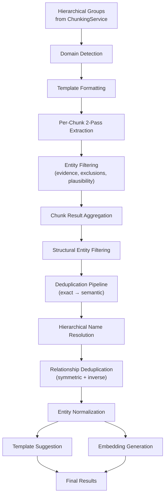
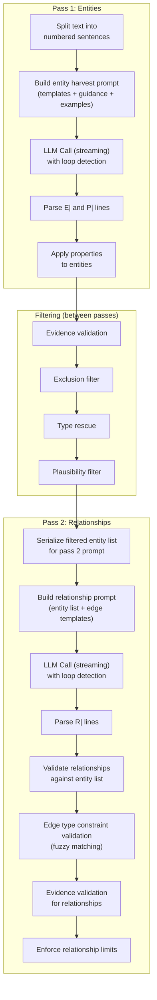
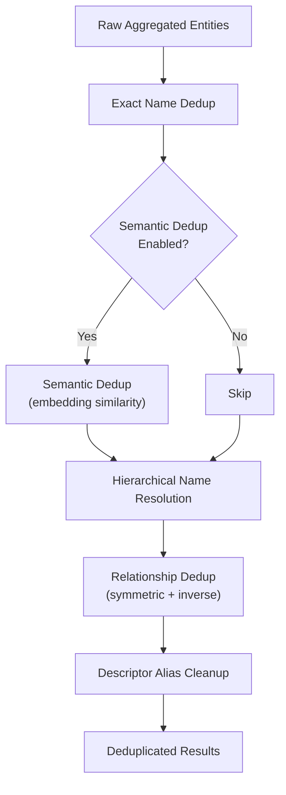

# Entity Extraction

Entity extraction is the AI-powered stage that transforms document text into structured knowledge graph entities and relationships. It is the most computationally expensive stage of the pipeline, relying on LLM calls for each chunk group, and includes extensive post-processing to clean, validate, and deduplicate the results.

**Source files:**

- `packages/core/src/chaoscypher_core/services/sources/engine/extraction/orchestration.py` -- shared orchestration functions
- `packages/core/src/chaoscypher_core/services/sources/engine/extraction/service.py` -- `ExtractionService`
- `packages/core/src/chaoscypher_core/services/sources/engine/extraction/extractor.py` -- extraction pipeline and deduplication
- `packages/core/src/chaoscypher_core/services/sources/engine/extraction/utils/ai_entities.py` -- `AIEntityExtractor` (LLM interaction)
- `packages/core/src/chaoscypher_core/services/sources/engine/extraction/utils/prompts.py` -- LLM prompt templates
- `packages/core/src/chaoscypher_core/services/sources/engine/extraction/utils/line_parser.py` -- pipe-delimited output parser
- `packages/core/src/chaoscypher_core/services/sources/engine/extraction/utils/entity_cleaner.py` -- validation and cleanup
- `packages/core/src/chaoscypher_core/services/sources/engine/extraction/domains/` -- domain registry and configuration

## Pipeline Overview



## Domain Detection and Selection

Before extraction begins, the system determines which packs a source extracts with. Every source extracts with the **floor** (`generic`: the eight core entity types and the core relationship labels) plus zero or more **packs** that add subtypes of the core types, extra relationship labels, guidance, examples and post-processing rules for a kind of content (literary, technical, scientific, etc.). See [Extraction Domains](../../user-guide/domains.md).

### How Domain Detection Works

The `DomainRegistry` auto-discovers domains from two locations:

1. **Built-in domains** -- JSON-LD files in `packages/core/src/chaoscypher_core/services/sources/engine/extraction/domains/plugins/`
2. **User domains** -- JSON-LD files in `data/plugins/domains/` (drop-in, no Python code required)

Each pack implements `can_analyze(text, filename, metadata)` which returns a `(can_handle, confidence)` tuple. The registry runs every pack against a text sample and proposes (`propose_packs`) every pack whose evidence — its score minus its own base score — reaches 0.30, highest score first, at most two. When no pack clears the bar the proposal is the floor alone, marked low confidence. The proposal waits for the user's confirmation unless packs were chosen at upload.

Users can also **choose** the packs (`packs` / `--pack`), bypassing auto-detection entirely; an empty list is the floor alone.

### What Domains Provide

| Component | Purpose | Used In |
|-----------|---------|---------|
| Entity guidance | Domain-specific instructions appended to entity extraction prompt | Pass 1 |
| Relationship guidance | Domain-specific instructions appended to relationship extraction prompt | Pass 2 |
| Node templates (the floor) and subtypes (packs) | The core types, each with every pack's subtypes of it | Pass 1 prompt |
| Edge templates | The core relationship labels, then each pack's extra ones | Pass 2 prompt |
| Examples | Few-shot examples for entity and relationship extraction | Both passes |
| Entity exclusions | Categories of things the LLM should skip | Pass 1 prompt + code-level filter |
| Type aliases and rescue keywords | Map a written type onto a subtype or a core type (the type rescue) | Post-processing |
| Extraction limits | Override global relationship density caps | Post-processing |
| Core types | Same-name entities merge only within one core type (two subtypes of one core type are one entity) | Deduplication |
| Title words | Honorifics/titles to exclude from name matching during dedup | Deduplication |

#### Phase 6: System-prompt customization (2026-05-08)

The `ExtractionSettings.system_prompt` setting lets operators replace the
default extraction system prompt entirely: it is a plain string whose default
*is* the built-in extraction system prompt, and editing it changes the system
prompt sent with every LLM extraction call (there is no null/unset state). A
pack cannot override it: `extraction_overrides` is a removed key
(`REMOVED_KEYS` in `extraction/domains/config_schema.py`), and a pack that
declares it is refused at load.

This is useful for operators running models that have been fine-tuned with
domain-specific system prompts, or for A/B testing prompt variants.

#### Phase 6: Template fallback for empty-template domains (2026-05-08)

When a domain has no node templates defined (e.g., a sparse custom domain
that relies entirely on the LLM's generic extraction), the formatter falls
back to the built-in generic templates by default
(`allow_template_fallback=True`, the legacy behaviour), logging a
`domain_node_templates_empty_using_fallback` warning so extraction always
has baseline type guidance.

Passing `allow_template_fallback=False` — a code-level option on
`format_domain_node_templates()`, not a `settings.yaml` key — turns an
empty template list into a hard `ValidationError` so misconfigured domains
surface immediately rather than silently producing generic output.

## Depth Strategy

Extraction operates at two depth levels, determined by the `analysis_depth` parameter:

| Depth | Groups Processed | Typical Use |
|-------|-----------------|-------------|
| `quick` | 5 evenly-distributed groups | Fast preview, cost-sensitive |
| `full` | All groups | Production extraction |

The `apply_depth_strategy()` function in `orchestration.py` uses **even-distribution sampling** for `quick` mode -- selecting every Nth group -- to ensure representative coverage across the document rather than just sampling the beginning.

:::note[Phase 6: Depth value validation (2026-05-08)]

`apply_depth_strategy()` now validates that `analysis_depth` is one of the
known literal values (`"quick"` or `"full"`) and raises a
`ChaosCypherException` subclass on an unknown value rather than silently
treating it as `full`. This prevents misconfigured per-source depth
overrides from producing unexpected output without any error signal.

:::

## Per-Chunk 2-Pass Extraction

Each hierarchical group is extracted using a **2-pass approach** that eliminates token competition between entities and relationships. This is the core of the `AIEntityExtractor.extract_single_chunk()` method.



### Why 2-Pass?

A single-pass approach forces the LLM to split its token budget between entities and relationships. In practice, this leads to either truncated entity lists or sparse relationship coverage. The 2-pass design gives each task the full token budget:

- **Pass 1** produces entities and properties with full context
- **Filtering** cleans the entity list between passes
- **Pass 2** receives a clean, validated entity list and focuses exclusively on relationships

### Pipe-Delimited Output Format

The extraction uses a simple, robust pipe-delimited format rather than tool calling or JSON output:

```
E|name|type|aliases|confidence|sent_ref|description
P|entity_index|key|value
R|source_index|target_index|type|confidence|sent_ref|justification
```

This format was chosen because:

- **No tool calling failures** -- works with any LLM, including local models
- **Greedy parsing** -- the last field (description/justification) absorbs unescaped pipes
- **Line independence** -- partial output is still usable if the LLM is interrupted
- **Evidence gating** -- `sent_ref` fields (e.g., `S1-S3`) link every extraction to source sentences

The parser (`line_parser.py`) requires `sent_ref` on every entity and relationship line — extractions without sentence references are rejected.

`parse_extraction_output()` accepts two keyword-only kwargs that thread
filtering-mode behaviour and quality-counter accounting into parsing:

- `minimum_alias_length: int` — drops aliases shorter than this from
  the parsed entity. Honours the active `FilteringConfig` so `maximum`
  / `strict` modes (length 3) shed `AI` / `ML` aliases that survive
  in `lenient` (length 2) and `unfiltered` (length 1).
- `stats: dict[str, int] | None` — caller-supplied counter dict the
  parser increments for malformed lines, out-of-bounds indices, and
  similar drops. Threaded through to `parser_lines_dropped` on the
  source row.

:::info[Production extraction parity]

The Cortex finalizer (`finalize_distributed_extraction`), the Neuron
worker (`_finalize_extraction_inner`), the standalone CLI extractor
(`extract_entities_from_groups`), and the MCP path all share one
post-extraction helper:
`apply_structural_and_normalization` in
`utils/post_extraction.py`. It runs `filter_structural_entities` (gated
on `FilteringConfig.enable_structural_filter`) followed by
`normalize_entity_types`, with both honouring the resolved domain's
custom structural and generic types. This guarantees that the same
input produces the same graph regardless of which entry point ran the
extraction.

:::

### Sentence-Referenced Evidence

Before extraction, the chunk text is split into numbered sentences:

```
S1: Prince Andrei returned from the war in 1805.
S2: He found his wife expecting their first child.
S3: Napoleon's forces had crossed the border.
```

Every entity and relationship must reference the sentence(s) that support it via the `sent_ref` field. This enables downstream evidence validation -- entities that cannot be traced back to their source sentences are filtered out.

### Prompt Structure

**Pass 1 (Entity Harvest):**

The `ENTITY_HARVEST_TEMPLATE` includes:

1. Numbered sentences from the chunk
2. The KNOWN ENTITIES block, from the source's second group on: the named entities the earlier groups produced (name, type, aliases but never a single word such as a diminutive or a given name alone, nor one opening with a possessive such as "my wife", up to three relation phrases), leaving out any record the filters kept but flagged (unevidenced, low plausibility, an excluded name, an unplaced type, or a listed name the name guard below could not support; a record that only lost a crossed alias is listed), at most `extraction.known_entities_limit` lines, so the model writes a later "the regiment" by the name an earlier group gave it; two guards in the filtering step drop an alias that names another listed entity and demote a listed name the cited sentences do not support
3. Node template definitions from the domain
4. Strict type enforcement instruction (if domain enables it)
5. Entity extraction guidelines (names as the text writes them, rich descriptions, alias rules)
6. Domain-specific entity exclusion rules
7. A worked example showing E| and P| lines
8. Domain-specific entity guidance (appended if available)
9. Domain-specific entity examples (appended if available)

**Pass 2 (Relationship Harvest):**

The `RELATIONSHIP_HARVEST_TEMPLATE` includes:

1. The same numbered sentences
2. The filtered entity list with indices (e.g., `0: Prince Andrei (Character) [aliases: Andrei; Prince Andrew]`)
3. Valid index range (0 to N-1)
4. Edge template definitions from the domain
5. Relationship extraction guidelines
6. A worked example showing R| lines
7. Domain-specific relationship guidance and examples

### Fuzzy Relationship Type Matching

After Pass 2 parses R| lines, each relationship's type is validated against the domain's edge templates. Rather than requiring an exact match, the system uses **three-tier fuzzy matching**:

| Tier | Method | Example |
|------|--------|---------|
| **1. Exact** | Case-insensitive exact match | `"interacts_with"` matches template `"interacts_with"` |
| **2. Substring** | LLM type is a substring of a template name (or vice versa) | `"interacts"` matches template `"interacts_with"` |
| **3. Word overlap** | Significant words (>= 3 chars) overlap between the LLM type and a template name | `"character_interaction"` matches `"interacts_with"` via shared root |

When a match is found, the relationship type is **rewritten** to the canonical template name. If no match is found, the behavior depends on the `strict_edge_type_constraints` setting:

- **`false`** -- unmatched types fall through and are kept as-is
- **`true`** (every extraction plan since October 2026) -- an unmatched type is kept as `related_to`, flagged `properties.unmatched_label: true` with the label as written under `properties.written_label`

The same setting also controls **source/target entity type validation**. When edge templates define `source_types` and `target_types`, the endpoint entity types are checked against those constraints, compared as core types. When `strict_edge_type_constraints` is `false`, source/target type mismatches fall through -- the relationship is kept even if the endpoint entity types don't match the template. When `true`, a mismatch is kept with its label, flagged `properties.type_mismatch: true` with the reason under `properties.type_mismatch_reason` ("parent_of takes a source of type Person, not Location").

Keep, flag, never delete (October 2026): until then strict mode dropped both, justification and all. Nothing is dropped now; the flagged relationships rank last in chat retrieval, with a capped one, and the graph canvas draws them thin. The `relationship_type_constraint` stage of the filtering log counts them under `counts.unmatched_label` and `counts.type_mismatch` (its `removed_count` is 0), and the source counts them in `relationships_unmatched_label_kept` and `relationships_type_mismatch_kept`; `relationships_dropped_type_unmatched` now counts the two together. Replayed over the v3 *War and Peace* graph (252 edges) under the floor's and the literary pack's constraints, the check refuses 9, every one the extraction's own type mistake; they are kept flagged and none is dropped.

This fuzzy matching significantly improves extraction quality because LLMs frequently produce slight variations of the intended relationship types (e.g., `"located_in"` vs `"located_at"`, `"member_of"` vs `"is_member_of"`).

### Direction Correction

When source/target entity types don't match the edge template's constraints, the pipeline attempts to auto-correct the direction by swapping source and target. If the swapped direction satisfies the constraints, the relationship is kept with corrected direction. This handles a common LLM error where relationships are extracted backwards (e.g., "WAR AND PEACE -> wrote -> Leo Tolstoy" is corrected to "Leo Tolstoy -> wrote -> WAR AND PEACE").

The correction logic runs before fall-through -- so a backwards relationship with a matching template gets fixed rather than passed through with wrong direction. If neither direction matches the constraints, the behavior follows `strict_edge_type_constraints` (flagged `type_mismatch` when strict, fall through when not). With direction correction off (`enable_direction_correction: false`), a relationship that fits only reversed is kept as written, flagged `type_mismatch` (until October 2026 it was dropped).

`RELATIONSHIPS_DIRECTION_CORRECTED` / `relationships_direction_corrected`
counts every detected wrong-direction relationship regardless of the
toggle — it measures the LLM's wrong-direction emission rate.
`enable_direction_correction` (Phase 4, default `True`) only changes the
handling: swap-and-keep (`True`, default) vs drop (`False`). See
[Relationship toggles](relationships.md#phase-4--phase-6-toggles-2026-05-08)
for the full cascade description.

## Loop Detection

LLMs can enter degenerate output states where they repeat the same pattern indefinitely. The `call_llm()` method streams the response and monitors completed lines in real-time for seven loop patterns:

| Pattern | Detection | Threshold Setting |
|---------|-----------|-------------------|
| **Entity count exceeded** | More than N entity lines | `loop_max_entity_count` |
| **Out-of-bounds indices** | Relationship lines referencing non-existent entity indices | `loop_max_out_of_bounds` consecutive OOB |
| **Repeating source-type** | Same `(source_index, relationship_type)` pair repeating | `loop_max_source_type_repeat` consecutive repeats |
| **Repeating property key** | Same `(entity_index, key)` pair repeating | `loop_max_property_repeat` consecutive repeats |
| **Invalid-relationship rate** | Fraction of relationship lines with out-of-bounds indices exceeds the threshold (checked only after a warmup count of lines) | `loop_invalid_relationship_rate_warmup` / `loop_invalid_relationship_rate_threshold` |
| **Total relationship count** | More relationship lines than `loop_max_relationship_multiplier` x the entity-count cap | `loop_max_relationship_multiplier` |
| **Repeated (source, target) pair** | Same `(source_index, target_index)` pair appearing too many times | `loop_max_same_pair` (default 6) |

When a loop is detected, the stream is **aborted early**, saving GPU time. The content collected up to that point is still usable -- the parser handles partial output gracefully.

The line parser (`_parse_mixed_lines`) also performs independent loop detection during parsing as a safety net, truncating output when the same degenerate patterns appear.

## Entity Filtering Pipeline

Between pass 1 and pass 2, extracted entities go through multiple filtering stages. Each stage produces an index mapping so downstream references (relationships, properties) can be remapped.

### Evidence Validation

Five modes controlled by the `evidence_validation_mode` extraction setting (a preset supplies the default; a pack cannot override it — the key is in `REMOVED_KEYS`):

| Mode | Entity Check | Relationship Check |
|------|-------------|-------------------|
| `strict` | Full name or alias appears in the referenced sentence(s) as consecutive whole words | Both endpoints named |
| `standard` (default) | Strict, or a naming word (>= 4 letters) of the name or an alias appears as a whole word, read through the domain's naming conventions (surname forms, plurals, a title the chunk's one candidate holds) | Both endpoints named, or one named plus a word of the domain's `relation_vocabulary` for the label; a label with no vocabulary words (`two_endpoints_only`) needs both |
| `narrative` | Standard, or a significant word of one of the entity's descriptors ("the little princess") | As standard, with the narrative naming |
| `relaxed` | Valid `sent_ref` in bounds is sufficient | Valid `sent_ref` is sufficient |
| `off` | Skipped entirely | Skipped entirely |

#### A relationship without evidence is kept, flagged

Keep, flag, never delete (October 2026). A relationship whose two endpoints
are entities of its chunk but whose cited sentence does not state it is
**kept**, not dropped: the evidence filter
(`evidence_validator.sort_relationships_by_evidence`, the one decision; the
verdict is `relationship_evidence`) sets `properties.unevidenced: true` and
records why in `properties.evidence_reason`, one sentence naming the failure:

| Failure | Reason it records (example) |
|---------|-----------------------------|
| `endpoints_not_named` | neither "Prince Vasíli" nor "Anna Pávlovna" is named in S15 |
| `relation_not_stated` | "Princess Mary Bolkónskaya" is named in S19 but "Anna Pávlovna" is not, and no word of the domain's relation vocabulary for related_to stands there |
| `label_needs_both_endpoints` | "St. Petersburg" is named in S6 but "Anna Pávlovna Schérer" is not, and located_in needs both endpoints named (the domain's relation vocabulary has no words for it) |
| `endpoint_not_named` | (strict mode) one endpoint named, and strict needs both |
| `known_endpoint_not_named` | "Count Varo Tesk" is not named in S4 (a known entity needs its name in the sentence) |
| `no_sent_ref`, `unreadable_sent_ref`, `sent_ref_out_of_range` | it cites no sentence, or none its chunk has |

`known_endpoint_not_named` means an endpoint is an entity the source already named in an
earlier group, and the cited sentences (or the one before them) do not write its name or a
distinctive alias of it: a title or kinship word alone ("the count", "her father") never names
such an entity, and a name the guard kept but flagged names none of its edges.

The edge is committed like any other, with its justification. The chat
context leaves it out unless `graphrag.include_unevidenced_edges` is on
([Search](../../user-guide/search.md#graphrag-tuning)), and the graph canvas
draws it dashed, its detail panel showing the reason. A copy of a fact its
chunk also states with evidence is folded into the evidenced copy (its
justification kept in `properties.justifications`) instead of being listed
twice, and the commit stores a fact written in several chunks as one edge
that is unevidenced only when every copy is. Only a relationship with an
endpoint that is no entity of its chunk is still dropped: it carries nothing.

The rules that decide whether a sentence states a relationship are
unchanged: what changed is what happens when one does not. On the B0
*War and Peace* Book One packs this was the largest deletion in the
pipeline, a third of what the model wrote (162 relationships on the
literary arm, 105 on the generic one); replayed offline under the new
filter, every one of them is kept (literary 157 flagged and 1 folded into
its evidenced copy, generic 99 and 4) and none is dropped. The counters are
`relationships_unevidenced_kept` (new) and `evidence_relationships_dropped`,
which now counts only the invalid-endpoint drops
([Quality Counters](quality-counters.md)).

#### An entity without evidence is kept, flagged

The same rule applies to the entity half of the filter (October 2026). An
entity whose cited sentence does not name it (or that cites no sentence, or
one outside its chunk) but that carries a description is **kept**, flagged
`properties.unevidenced: true` (the key the relationships use) with the
reason in `properties.evidence_reason` ("\"Anna Pávlovna\" is not named in
S2"); `evidence_validator.sort_entities_by_evidence` is the one decision.
Pass 2 then lists it, so its relationships can attach to it; chat retrieval
ranks it after every undoubted entity of its standing, and the graph canvas
links it to its "Unresolved (N)" node. Only an entity that carries nothing is
dropped. The rules that decide whether a sentence names an entity are
unchanged. The `entity_evidence_filter` stage counts the drops as its
`removed_count` and the flags under `counts.unevidenced_kept`; the source's
`entities_unevidenced_kept` counter adds the flags up, and
`evidence_entities_dropped` now counts only the drops. On the B0 *War and
Peace* packs the old rule dropped 1 literary entity and no generic one.

The `narrative` mode sits between `standard` and `relaxed` and is designed for literary and narrative content where characters are often referred to by pronouns or descriptive phrases rather than by name. It comes with the `lenient` preset (the `biographical` and `historical` packs); the `literary` pack names no preset and so takes the floor's `balanced`, whose evidence mode is `standard`.

The `off` mode bypasses both the entity and relationship evidence filters entirely. It is pinned automatically by the `unfiltered` filtering preset rather than configured directly.

### Exclusion Filter

A code-level safety net that catches entities the LLM extracted despite being told to skip them in the prompt. Domain-specific exclusion rules (e.g., pronouns, page furniture, a raw number that belongs in a property) are applied as pattern matches against entity names and types.

An exclusion names only what carries no fact. A record that carries evidence is kept and flagged, never dropped: an entity whose name matches an exclusion example and that carries a description, or a reference that says something of its own, is kept flagged `properties.excluded_name: true` with the rule that matched under `properties.excluded_by` (until October 2026 a non-person one was dropped); only one carrying nothing is dropped. The `entity_exclusion_filter` stage counts the flags under `counts.excluded_name_kept` and the source's `excluded_entities_kept` counter adds them up. The prompt is held to the same rule: no shipped domain tells the model to skip a person called only by a title or a role ("the count", "the plaintiff"). The floor's TITLES rule says to write the name when the passage gives one and the title as the passage writes it when it does not, and the deduplication folds or flags that reference. A guard test (`test_prompt_content_guards.py`) fails on an exclusion that is not on its reviewed list, or on guidance that tells the model to leave out a record carrying a fact: a bare title, a role word, "minor", "only the main", "unless", or a limit on how many.

### Type Rescue

Every entity leaves the per-chunk filters typed as one of the floor's eight core types (Person, Organization, Location, Event, Work, Concept, Object, Group), with a pack's subtype kept as the `entity_subtype` property. The rescue always runs, and reads what the model wrote in the type column in this order:

1. **An exact core type** is itself. **`Core/subtype`**, the form the prompt teaches (each core type's line lists its subtypes as the slugs to write, `(subtypes: author, character, narrator — write Person/author)`), is the subtype's core type with that subtype: `Person/character` is Person / `character`, and `Location/character` is Person / `character` too (the subtype's own core type wins over the one written). A subtype no selected pack offers (`Person/wizard`) is kept on the written core type, flagged `properties.unplaced_type: true` with `properties.written_type` `Person/wizard`, and counted under `unplaced_subtype`.
2. **A pack's alias** (`type_aliases`, exact key) is read as its target: literary's `Historical Figure` is its `Character` subtype.
3. **A name the mapping table knows** gives its core type and subtype (`Character` → Person / `character`, `Military Unit` → Organization / `military_unit`): the selected packs' own rows first (news's `Publication` is an outlet, an Organization), then the shared row, then the packs' own subtype names.
4. **The selected packs' rescue keywords** (each subtype's `rescue_keywords`, then the pack's `core_rescue_keywords`), matched as whole words in the description and then the written name, give the subtype or core type they belong to: under literary, `Countess` is Person / `character` and `Battle` is Event.
5. **The floor's normalization keywords**, matched the same way, give a core type with no subtype.
6. **A reference that says something of its own**, such as `the count` or `Natásha's mother`, is typed Person when its own words name a person (a title, or a relation or role word).

An empty type column states no type, so only the keywords in its description, or the reference rule, can rescue it. A pronoun (`he`, `she`, `a man`, `a woman`) is never a rescue keyword. Any other entity is kept as a `Concept`, flagged `properties.unplaced_type: true` with the type as written under `properties.written_type`, and counted under `unknown_type` in the `type_rescue` stage of the chunk's filtering log and in the source's `unplaced_type_entities_flagged` counter (until October 2026 it was dropped, description and all). The exact deduplication reads such a Concept as no type: a mention of `Natásha` whose type column was empty joins the `Natásha` the other mentions typed Person, when the name has one core type. No entity is stored as `UNKNOWN`. The per-chunk filter and `rescue_type()` run the same ordered decision (`TypeVocabulary.decide`).

:::note[`enable_type_rescue` gates the salvage tiers only]

`FilteringConfig.enable_type_rescue` (default `True`; the `minimal` and
`unfiltered` presets turn it off) gates the rescue's two salvage tiers:
dropping obvious junk (an empty name, a name equal to its type, a single
stop word) and absorbing a property-like type into its target's property
(`absorbs_types`). The core-type rescue itself always runs. It is **not** an
`ExtractionSettings` key — setting it in `settings.yaml` fails validation.

:::

### Plausibility Filter

Catches LLM-hallucinated descriptive names that read like sentence fragments rather than proper entity names. Uses configurable thresholds:

- `plausibility_threshold` -- for entity types that require proper named referents
- `plausibility_threshold_non_named` -- for other entity types (more lenient)

A name below the bar that carries evidence (a description or an evidence
sentence) is **kept**, flagged `properties.low_plausibility: true` with its
score under `properties.plausibility`; only one carrying nothing, and an
empty name, is dropped. The `implausible_entity_filter` stage counts the
drops as its `removed_count` and the flags under `counts.low_plausibility`,
and the source's `plausibility_entities_flagged` counter adds them up. Until
October 2026 every name below the bar was dropped, description and all
(`conservatory`, `doll`, `drawing room` on a novel's first book). A record
written under a reference that says something of its own (`the count`, and
of any type `the army`, `the government`, `the village`) is never scored: it
is kept and the deduplication flags it `descriptor_reference`.

## Chunk Result Aggregation

After all chunks are processed, results are aggregated by `aggregate_chunk_results()`:

1. Entity lists from all chunks are concatenated into a global list
2. Relationship indices are **remapped from chunk-local to global** -- if chunk 0 produced 5 entities, chunk 1's entity index `0` becomes global index `5`
3. Chunk texts and sentence lists are collected for downstream reference

Within-task duplicate relationships (same source/target/type from the same extraction task) are merged, keeping the highest confidence and combining justifications.

## Deduplication Pipeline

The deduplication pipeline (`run_deduplication()`) collapses duplicate entities that appear across different chunks.



### Exact Name Deduplication

The first pass uses `EntityProcessor.deduplicate_entities_with_mapping()` to merge entities with identical or alias-matching names. Two entities are candidates for merging when:

- Their names match (case-insensitive) or one's name matches another's alias
- Their types are compatible (either identical, or within the same type compatibility group if the domain defines one)

Merged entities combine descriptions, aliases, properties, and source chunk references. The highest confidence is kept.

### Semantic Deduplication

When `entity_deduplication_mode` is set to `semantic` (the default), a second pass uses embedding similarity to catch entities that refer to the same thing but have different names (abbreviations, alternate spellings, etc.):

1. Generate embeddings for all surviving entities
2. Compare embedding similarity against `semantic_dedup_threshold`
3. Merge pairs that exceed the threshold and pass type compatibility checks

The embeddings generated during semantic dedup are cached and reused for the final entity embedding generation, avoiding redundant computation.

### Hierarchical Name Resolution

After deduplication, `resolve_hierarchical_names()` handles cases where one entity name is a substring of another (e.g., "Moscow" vs "Battle of Moscow"). The shorter name is resolved to the more specific entity when the context supports it.

### Relationship Deduplication

`deduplicate_relationships()` collapses duplicate relationships and handles two special cases:

- **Symmetric relationships** (e.g., `spouse_of`, `interacts_with`) -- `(A, B)` and `(B, A)` are semantically identical; only the highest-confidence direction is kept
- **Inverse relationships** (e.g., `parent_of` / `child_of`) -- `(A, parent_of, B)` and `(B, child_of, A)` are collapsed to the canonical direction

Both symmetric and inverse relationship types are defined per-domain.

### Descriptor Alias Cleanup

The final cleanup pass (`clean_descriptor_aliases()`) removes aliases that are descriptive phrases rather than proper name variants (e.g., "the old prince" as an alias for "Prince Nikolai Bolkonsky"). Domain-provided title words are used to identify and filter these.

## Structural Entity Filtering

Before deduplication, `filter_structural_entities()` removes entities that represent document structure rather than meaningful content (chapters, sections, page headers). Domain configurations specify which entity types are considered structural and which are generic catch-all types.

A pack can disable this step with `enable_structural_filter: false` in its `extraction_limits` (the `FilteringConfig` field name; any other key is silently ignored).

## Type Normalization

After deduplication, the floor's normalization keywords retype entities that carry a generic fallback type; packs declare no rules of their own. See [Type Normalization](./deduplication.md#type-normalization).

## Finalization

The `ExtractionService.finalize_distributed_extraction()` method performs the final steps:

### Entity Normalization

`normalize_entities()` ensures every entity has a consistent structure with all required fields and sensible defaults:

- `id`, `name`, `type`, `description`, `properties`, `aliases`, `confidence`
- `chunk_index`, `sent_ref`, `source_chunk_indices`

### Template Suggestion

Two types of template suggestions are generated concurrently:

1. **Node template suggestions** -- `TemplateExtractor.generate_suggestions_from_entities()` analyzes extracted entity types and suggests graph templates that don't already exist
2. **Edge template suggestions** -- `suggest_edge_templates()` analyzes relationship types and suggests edge templates, using domain descriptions when available

### Embedding Generation

Entity embeddings are generated for vector search in the knowledge graph. The process reuses cached embeddings from semantic deduplication when the count matches, avoiding redundant computation:

```
Cached embeddings count == entity count?
├─ Yes → Reuse cached embeddings (zero additional embedding calls)
└─ No  → Generate fresh embeddings via the embedding provider's batch_embed()
```

Each entity's embedding text is constructed from its name, type, and description to create a semantically rich representation.

## Quality Score Caching

After extraction completes, `cache_quality_scores()` computes quality metrics and persists them to the source file record. This is a non-blocking operation -- if scoring fails, extraction is not aborted. Scores are computed once at extraction time so they don't need recalculation on every page load.

Quality scoring takes into account:

- Entity and relationship counts
- Entity chunk mention distribution
- Domain-specific scoring configuration
- Overall extraction coverage relative to document size

## Filtering Modes

The `extraction_filtering_mode` setting selects a **preset** that controls which quality filters are active and how strict they are. This replaces the need for domains to individually configure evidence validation, type constraints, plausibility thresholds, and relationship limits -- instead, each domain simply declares a preset and optionally overrides specific values.

### Available Presets

| Preset | Evidence | Type Constraints | Plausibility | Relationship Limits | Orphan Protection |
|--------|----------|-----------------|--------------|--------------------|--------------------|
| **`maximum`** | Full name/alias match | Flag on mismatch | Tighter thresholds | All active | Off |
| **`strict`** | Full name/alias match | Flag on mismatch | Standard thresholds | All active | Off |
| **`balanced`** (default) | Significant word match | Fall-through on mismatch | Standard thresholds | All active | Off |
| **`lenient`** | Lenient (pronoun-heavy prose) | Fall-through on mismatch | Lower thresholds | All active | Off |
| **`minimal`** | Relaxed (valid sent_ref only) | Disabled | Elevated limits | Most filters disabled | On |
| **`unfiltered`** | Disabled | Disabled | Disabled | Data integrity only | On |

Orphan protection (`protect_orphans`) exempts an endpoint with fewer than 2 edges from the relationship caps and keeps, at commit, the orphan entities that carry neither a description nor an evidence sentence. An orphan that carries either is committed under every preset, flagged `properties.orphan` ([Commit](commit.md#orphan-entities-keep-flag-never-delete)).

**`maximum`** enables all filters with the tightest thresholds. Evidence validation requires full name or alias substring matches. Plausibility threshold is tighter than `strict`. Best for cases where absolute precision is required.

**`strict`** uses strict evidence validation and type constraints (flagging mismatches) with standard plausibility thresholds. Best for factual and structured content where entities have formal names and relationships follow well-defined schemas.

**`balanced`** (the default) activates all filters with fall-through behavior -- unmatched relationship types and entity type mismatches are kept unflagged rather than flagged (an extraction plan runs the type check strict whatever the preset). Suitable for most general content.

**`lenient`** uses narrative evidence validation designed for prose where characters are often referenced by pronouns or descriptive phrases rather than by name. Plausibility thresholds are lowered to accommodate literary naming conventions. All other filters remain active with fall-through behavior.

**`minimal`** disables most quality filters. Evidence validation only requires a valid sentence reference. Type constraints are disabled. Relationship limits are elevated. Useful for content where aggressive filtering would lose too much signal (e.g., news articles with many loosely-connected entities).

**`unfiltered`** provides data integrity only -- deduplication and index validation run, but no quality filtering is applied. Entities and relationships pass through as extracted. Useful for debugging extraction prompts or when all filtering will be done downstream.

Legacy preset names (`standard`, `precise`, `narrative`, `permissive`, `raw`) are no longer accepted and raise an error — use one of the six canonical names (`unfiltered`, `minimal`, `lenient`, `balanced`, `strict`, `maximum`).

### Domain-to-Preset Mapping

The floor and each built-in pack map to one of these presets:

| Preset | Floor and packs |
|--------|---------|
| **`balanced`** | generic (the floor), design, educational, financial, philosophical, political, reference, technical, theological |
| **`strict`** | cybersecurity, intelligence, investigation, legal, medical, scientific |
| **`lenient`** | biographical, historical |
| **`minimal`** | news |

The `literary` pack names no preset and takes the floor's. A source's packs give the preset when they name one (packs naming different presets fall back to the floor's). Specific filter values can still be overridden per pack via `extraction_limits` -- the preset provides the baseline, and overrides are applied on top, except that a pack's `loop_max_entity_count` and `minimum_alias_length` move with a mode the user chooses away from `balanced` ([Domain packs and the slider](../../reference/filtering-modes.md#domain-packs-and-the-slider)); the floor's `max_entity_degree` (80) and `max_same_source_type` (20) can only be raised.

### Override Hierarchy

The filtering mode can be set at three levels, with each level overriding the previous:

1. **Global default** — `balanced` preset
2. **Domain config** -- `extraction_filtering_mode` field in the domain's `.jsonld` file
3. **Per-source override** -- Set via the API, CLI, or UI when adding a document

## Relationship Limits

Multiple layers of relationship limiting act as a **safety net** to prevent extraction from producing an unmanageable graph. These are not primary quality filters -- they catch runaway cases where the LLM produces disproportionate relationship counts:

| Limit | Setting | Default | Description |
|-------|---------|---------|-------------|
| Ratio cap | `max_relationship_ratio` | 8.0 | Max relationships as a multiple of entity count |
| Degree cap | `max_entity_degree` | 80 (the floor's) | Max relationships per entity (source + target combined) |
| Source-type cap | `max_same_source_type` | 20 (the floor's) | Max relationships with the same (source, type) pair |

These defaults are intentionally generous. Primary extraction quality comes from evidence validation, type constraints, and deduplication -- the limits above only activate when those upstream filters are insufficient. All limits can be overridden per-domain via `extraction_limits`. When trimming is needed, lower-confidence relationships are dropped first.

### Orphan Protection

Both the degree cap and the total ratio cap include **orphan protection**: if either endpoint of a relationship has fewer than 2 edges, the relationship is kept regardless of whether the other endpoint has hit the degree cap or whether the total relationship count has exceeded the ratio cap. For the total ratio cap, relationships that protect near-orphan entities are exempt from the count entirely -- they don't count toward the limit. This prevents both caps from disconnecting sparsely-connected entities that would otherwise become orphaned nodes in the graph.

## Distributed Extraction

Chaos Cypher supports three execution modes for extraction:

1. **Standalone** (`extract_from_chunks`) -- processes all chunks sequentially in a single call, used by the CLI
2. **Distributed** (`finalize_distributed_extraction`) -- chunks are processed in parallel via the queue system (Neuron workers), then aggregated and finalized
3. **[Model Context Protocol](https://modelcontextprotocol.io/) (MCP) Extraction** -- external tools process chunks via the MCP protocol, with results stored as `ExtractionSubmission` records for incremental commit

The distributed path splits extraction into per-chunk jobs dispatched to the LLM queue, then calls `finalize_distributed_extraction()` to run the deduplication pipeline, template matching, and embedding generation on the aggregated results. This is the production path used by the Cortex backend.
