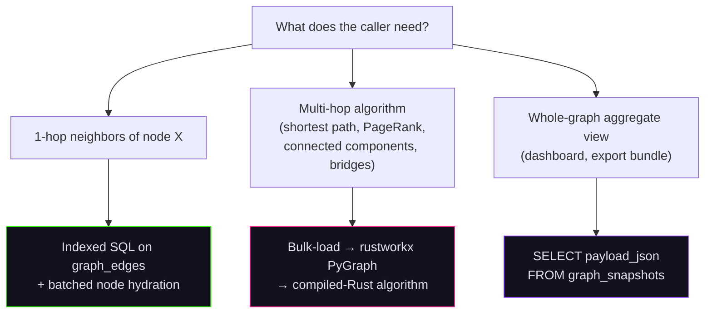

# Knowledge Graph Storage

The knowledge graph lives in plain SQLite tables and is traversed by an in-process Rust graph library. SQL handles persistence and trivial 1-hop lookups; multi-hop algorithms run in [rustworkx](https://www.rustworkx.org/), and whole-graph views read a precomputed snapshot. This page describes the schema, the three read patterns, and the trade-offs.

## Storage Layout

Each database (workspace) gets one SQLite file:

```
{CHAOSCYPHER_DATA_DIR}/databases/{database_name}/app.db
```

Resolved by `get_db_path()` in `packages/core/src/chaoscypher_core/adapters/sqlite/engine.py`. Every connection loads the [`sqlite-vec`](https://github.com/asg017/sqlite-vec) extension so vector search runs in the same process.

Six tables hold the graph:

| Table | Role |
|---|---|
| `graph_nodes` | Entities (people, organizations, concepts, …) |
| `graph_edges` | Relationships between nodes |
| `graph_node_sources` | Which sources attest each node, with what each one wrote |
| `graph_edge_sources` | Which sources attest each edge, with what each one wrote |
| `graph_templates` | Type schemas for nodes and edges |
| `graph_snapshots` | Precomputed `GraphBreakdown` payload for dashboard reads |

Defined in `packages/core/src/chaoscypher_core/adapters/sqlite/models.py`.

## Schema

### `graph_nodes`

| Column | Type | Notes |
|---|---|---|
| `id` | TEXT, PK | `node_<24-hex>` — content-addressed (see [Stable IDs](#stable-ids-and-idempotent-commits)) |
| `database_name` | TEXT, indexed | Workspace scope |
| `graph_name` | TEXT | `'knowledge'` |
| `template_id` | FK → `graph_templates`, RESTRICT | Type schema |
| `label` | TEXT | Display name |
| `properties` | JSON | Free-form property bag matching the template |
| `position_x`, `position_y` | FLOAT | Canvas coordinates (optional) |
| `embedding` | JSON array | Float32 vector for similarity |
| `source_id` | FK → `sources`, SET NULL | Home source — one of the node's members (see [Provenance](#provenance-membership-and-the-enabled-filter)) |
| `created_at`, `updated_at` | DATETIME UTC | |

Indexes on `(database_name, source_id)` and `(database_name, template_id)`.

### `graph_edges`

| Column | Type | Notes |
|---|---|---|
| `id` | TEXT, PK | `edge_<24-hex>` — content-addressed |
| `database_name`, `graph_name` | TEXT | `graph_name` always `'knowledge'` |
| `template_id` | FK → `graph_templates`, RESTRICT | Relationship type |
| `source_node_id` | FK → `graph_nodes`, CASCADE, indexed | "From" endpoint |
| `target_node_id` | FK → `graph_nodes`, CASCADE, indexed | "To" endpoint |
| `label` | TEXT | Human-readable predicate (`"worked_at"`) |
| `properties` | JSON | Edge properties |
| `source_id` | FK → `sources`, SET NULL | Home source — one of the edge's members |
| `ccx_iri` | TEXT, indexed | The edge's CCX IRI when a package wrote it |
| `valid_from`, `valid_to` | TEXT (ISO date) | Validity window (migration 0020): `valid_to` set means a later memory on a single-valued relation closed this edge |
| `closed_by_source_id` | TEXT | The memory source that closed the edge; releasing it reopens the edge |

Two endpoint indexes — `ix_graph_edges_db_source_node` and `ix_graph_edges_db_target_node` — make 1-hop neighbor lookups O(degree).

### `graph_templates`

`id`, `database_name`, `name`, `template_type` (`'node'` or `'edge'`), `properties` (JSON array of property definitions), `icon`, `color`, `embedding`, `source_id` (owning source, FK → `sources`, SET NULL). Templates are referenced by both `graph_nodes` and `graph_edges` with `ON DELETE RESTRICT` — you cannot delete a template that is in use.

### `graph_node_sources` and `graph_edge_sources`

| Column | Type | Notes |
|---|---|---|
| `node_id` / `edge_id` | FK → `graph_nodes` / `graph_edges`, CASCADE, PK | The attested row |
| `source_id` | FK → `sources`, CASCADE, PK, indexed | An attesting source |
| `snapshot` | JSON | What that source wrote for the row: a node's label, type, aliases and properties (no embedding); an edge's endpoints, label and properties |

One row per (node or edge, source). A node written by one source has one membership; identity resolution merging nodes from several sources gives the kept node one membership per source. These tables, not `source_id`, decide what a source delete removes and which nodes a disabled source hides.

### `graph_snapshots`

One row per database (`database_name` is the primary key). Stores a serialized `GraphBreakdown` Pydantic model in `payload_json` plus scalar summary columns (`node_count`, `edge_count`). Rebuilt by the `OP_BUILD_GRAPH_SNAPSHOT` operation handler (`operations/graph_snapshot_handler.py`) after commits or on manual refresh.

## Three Traversal Patterns

Use the right pattern for the depth of the question.



### Pattern 1 — 1-hop: indexed SQL

**When to use:** "Give me the edges and neighbors of node X."

The edge table has separate indexes on `source_node_id` and `target_node_id`, so each direction is a B-tree lookup. Run both, union the endpoints, then batch-fetch node labels in a single query.

**Implementation:** `packages/core/src/chaoscypher_core/adapters/sqlite/repos/graph/sqlite_edge_ops.py`

**Example** (from `services/workflows/tools/engine/handlers/graphrag_handlers.py`):

```python
neighbor_ids: set[str] = set()
edges_by_node: dict[str, list[Any]] = {}

for nid in seed_node_ids:
    outgoing = list(self.graph.list_edges(source_node_id=nid, limit=50))
    incoming = list(self.graph.list_edges(target_node_id=nid, limit=50))
    edges_by_node[nid] = outgoing + incoming
    for e in outgoing:
        neighbor_ids.add(e.target_node_id)
    for e in incoming:
        neighbor_ids.add(e.source_node_id)

# Single batched fetch — never call get_node() in a loop
all_needed = neighbor_ids | set(seed_node_ids)
all_fetched = self.graph.get_nodes_batch(list(all_needed))
nodes_map = {n.id: n for n in all_fetched}
```

### Pattern 2 — multi-hop: rustworkx

**When to use:** Shortest path, PageRank, connected components, bridge detection, betweenness centrality, clustering coefficient.

The traversal layer bulk-loads nodes and edges out of SQLite, builds a `rustworkx.PyGraph` (or `PyDiGraph` for directed algorithms), runs the algorithm in compiled Rust on integer indices, and maps the result back to string node IDs.

**Implementation:** `packages/core/src/chaoscypher_core/services/graph/engine/traversal.py`

```python
import rustworkx as rx

def build_graph(nodes, edges):
    """Build an undirected rustworkx graph and return the index maps."""
    graph = rx.PyGraph()
    id_to_idx: dict[str, int] = {}

    for node in nodes:
        idx = graph.add_node(node.label)
        id_to_idx[node.id] = idx

    idx_to_id = {v: k for k, v in id_to_idx.items()}

    added = set()
    for edge in edges:
        src, tgt = edge.source_node_id, edge.target_node_id
        if src in id_to_idx and tgt in id_to_idx:
            pair = (min(src, tgt), max(src, tgt))
            if pair not in added:
                graph.add_edge(id_to_idx[src], id_to_idx[tgt], None)
                added.add(pair)

    return graph, id_to_idx, idx_to_id


def find_shortest_path(nodes, edges, source_id, target_id):
    graph, id_to_idx, idx_to_id = build_graph(nodes, edges)
    paths = rx.dijkstra_shortest_paths(
        graph, id_to_idx[source_id], target=id_to_idx[target_id]
    )
    if id_to_idx[target_id] not in paths:
        return {"success": False, "error": "No path found between nodes"}
    return {
        "success": True,
        "path": [{"id": idx_to_id[i]} for i in paths[id_to_idx[target_id]]],
    }
```

The same `build_graph` / `build_digraph` entry points feed the algorithms in `services/graph/engine/algorithms.py` and `traversal.py`:

| Algorithm | rustworkx call |
|---|---|
| Shortest path | `rx.dijkstra_shortest_paths()` (`traversal.py`) |
| Connected components | `rx.connected_components()` |
| PageRank | `rx.pagerank()` |
| Betweenness centrality | `rx.betweenness_centrality()` |
| Clustering coefficient | Triangle counting on `rx.PyGraph` |
| Bridges | Tarjan's DFS in pure Python (`traversal.py`) |

Every load goes through `list_nodes(minimal=True)` / `list_edges(minimal=True)` to keep the projection narrow — `embedding` (a fat JSON column on nodes) and `properties` are excluded from analytics loads.

### Pattern 3 — whole-graph aggregate: snapshot read

**When to use:** Dashboard cards, export bundles, anything that wants "the shape of the whole graph" without recomputing it.

The `OP_BUILD_GRAPH_SNAPSHOT` operation handler runs `BuildGraphSnapshotService`, which assembles a `GraphBreakdown` (counts, per-template stats, per-source breakdown) and writes the JSON payload into `graph_snapshots.payload_json`. Read paths fetch by primary key:

```python
# packages/core/src/chaoscypher_core/adapters/sqlite/repos/graph_snapshot.py
class GraphSnapshotRepository:
    def get_current(self, database_name: str) -> GraphBreakdown | None:
        with Session(self._engine) as session:
            row = session.get(GraphSnapshot, database_name)
            if row is None:
                return None
            return GraphBreakdown.model_validate_json(row.payload_json)
```

The snapshot is rebuilt via `import_service.py` after commits, so dashboard reads stay O(1) regardless of graph size.

## Stable IDs and Idempotent Commits

The commit pipeline must survive crashes — if the commit handler writes half its nodes and is re-dispatched, the second attempt must not create duplicates. Node and edge IDs are therefore content-addressed:

```python
# packages/core/src/chaoscypher_core/adapters/sqlite/repos/graph/sqlite_node_ops.py
def _stable_node_id(database_name, source_id, template_id, label) -> str:
    canonical_label = (label or "").strip().lower()
    scope_source = source_id or "no_source"
    raw = f"{database_name}:{scope_source}:{template_id}:{canonical_label}"
    return f"node_{hashlib.sha256(raw.encode()).hexdigest()[:24]}"
```

Edges hash `(db, source, template, source_node_id, target_node_id, label)`. Because endpoint node IDs are themselves stable, edge IDs are stable across commit attempts.

`upsert_nodes_batch()` and `upsert_edges_batch()` use these IDs to do bulk `SELECT ... WHERE id IN (...)` checks, then INSERT only the missing rows. **First write wins** — when a stable key already exists, the row is left untouched. This is deliberate: a partial re-run must not silently overwrite already-committed state.

For the full commit pipeline see [Commit to Graph](./extraction-pipeline/commit.md).

## Provenance, Membership and the "Enabled" Filter

`source_id` on a node or edge names its **home** source. The membership tables name **every** source that attests it, each with a snapshot of what that source wrote. Identity resolution can merge nodes extracted from different sources into one node; the merge moves the dropped node's memberships, snapshots and citations to the kept node, so the kept node records every source that contributed to it.

**Deleting a source releases it.** A source delete, a re-commit and a forced re-extract all take the source out of the graph the same way, in one transaction with the source-row change:

1. The edges the source had closed (`closed_by_source_id`) are reopened, then the source's memberships are removed.
2. A node or edge no source attests any more is deleted (an edge also goes with a deleted endpoint).
3. A node or edge another source still attests survives and is **rebuilt** from the snapshots of the sources it still has: the survivor ranking picks the reading whose label it keeps, the other readings fold into it, and a node is re-homed to that reading's source; an edge's readings fold their properties together and it is re-homed to its lowest remaining member. Sources that wrote the same thing count as one reading (provenance such as `source_document_id` aside), so a reading never folds into itself, and the current home keeps the node when it holds the chosen reading. Nothing the released source wrote stays on it.
4. A template the source owned is deleted when nothing uses it, and otherwise handed to a source that still attests one of its users. When that source (or, for users with no membership, the unowned templates) already has a template of the same type and name, the users move to it and the released template is deleted. A system template is never that twin: a user template is not folded into it.

After the commit, identity resolution runs again over the rebuilt nodes, and the rebuilt nodes are re-embedded and re-indexed. Each merge group, the alias drops and the flags commit as their own unit under the writer lock, so a failure partway leaves the units before it applied; the search cleanup and the re-embedding then cover exactly those. The search index follows only the nodes the resolution changed: the merged-away nodes lose their keyword and vector rows and the changed nodes have their full-text rows rewritten (`SearchRepository.refresh_node_fulltext`). The whole-table rebuild (`rebuild_node_fulltext`) is reserved for an explicit reindex; at 200,000 nodes it held the writer lock for 11 s. Deleting a source row directly no longer cascades: the foreign keys are `ON DELETE SET NULL`, so graph rows only ever leave through the release.

A re-commit lands on the same content-addressed ids as the source's first commit. When one of those rows outlived the release because another source attests it, the re-committing source gets its membership back with what it writes now, and the row is rebuilt from all its members again.

**A CCX import records what its package says.** The importer upserts each entity by its CCX IRI, then links every node its package cites to the importing source. The membership snapshot is the package's own entity, never the node's row: when the IRI names a node that other sources share (a merge folded them in), the row carries every member's names, and a later release would rebuild the node from them. A node the package has no entity for falls back to its own pre-merge reading (its home source's snapshot, as it is). Each package reading carries its own source's `source_document_id`. The upsert names no source and leaves every existing membership alone, whoever the members are: the same IRI may be another package's entity, whose reading this content is not. A node the package upserts but no chunk cites keeps a reading only when one of the import's own sources is its sole member (a re-import of the package that wrote it); that reading is refreshed from the package. Edges get memberships too: a single-source import attests every edge it wrote and a bundle attests each edge from every source citing it, each with the package's reading of the edge, and the edges are rebuilt from their members (which writes a memory's `valid_from`). Once the links are in, a node that a source from outside the import attests too is rebuilt from all its members, so deleting any one of them later removes that source's names and keeps the others'. Such a re-import can therefore change the node's label and home source (the survivor ranking picks among every member's reading). A node only the import's own sources attest (a multi-source bundle citing one entity from several sources) is left as the package wrote it, homed at its first citer. A rebuilt node whose text changed has its vector cleared after the bundle's vectors are restored, so the import's indexing, which embeds only nodes with no vector, re-embeds it from its new text; its full-text row follows there too. An import with no embedding model leaves such a node without a vector until the search indexes are rebuilt.

**Disabling a source hides what only it attests.** Default list queries show a node or edge while at least one of its member sources is enabled; a row with no membership (a manual or legacy row) is shown unless its own `source_id` names a disabled source. A merged node stays visible while any of its sources is enabled, and per-source counts count it once under each member. Pass `include_disabled_sources=True` to bypass.

```python
# Default: hides data no enabled source attests
nodes = graph_repo.list_nodes(template_id="tpl_person")

# Admin / export: include everything
nodes = graph_repo.list_nodes(template_id="tpl_person", include_disabled_sources=True)
```

## Trade-offs

The design is consciously skewed toward operational simplicity over arbitrary scale.

**Wins:**

- One file per workspace — `cp app.db` is a complete backup.
- `sqlite-vec` runs vector search inside the same connection — no separate index service.
- Source memberships make "delete source → everything only it attests is gone, everything another source also attests is rebuilt from that source" one release in one transaction.
- `rustworkx` is fast: a 10k-node / 100k-edge graph builds and runs Dijkstra in tens of milliseconds, all in compiled Rust.

**Costs:**

- Multi-hop algorithms load the graph into RAM. The bound is configurable but real:

  ```yaml
  # settings.yaml
  batching:
    graph_analysis_node_limit: 1500000   # default 1.5M
    graph_analysis_edge_limit: 4000000   # default 4M
  ```

  Defined in `packages/core/src/chaoscypher_core/settings.py` (`BatchingSettings`). Above these limits, analytics return partial results.

- Recursive CTEs are not used. There is no SQL-side multi-hop traversal. If you find yourself wanting one, you have outgrown this design and should add a graph backend behind `GraphRepositoryProtocol`.

## Anti-Patterns

**Hydrating neighbor nodes**

When you need each edge's source and target nodes, pass `with_nodes=True` so the
repository batch-loads them in a single query:

```python
edges = graph_repo.list_edges(with_nodes=True)
for edge in edges:
    print(f"{edge.source_node.label} → {edge.target_node.label}")
```

Calling `get_node()` inside a loop produces O(N) round trips and is significantly slower:

```python
# ❌ Don't do this
edges = graph.list_edges(source_node_id=nid)
for e in edges:
    neighbor = graph.get_node(e.target_node_id)  # N+1 SELECTs
```

✅ **DO** use `with_nodes=True` (one batch SELECT for all endpoints), or manually
collect IDs and call `get_nodes_batch()` when you only need a subset:

```python
edges = graph.list_edges(source_node_id=nid)
neighbor_ids = {e.target_node_id for e in edges}
neighbors = graph.get_nodes_batch(list(neighbor_ids))  # one SELECT
```

❌ **DON'T write a recursive CTE for shortest path or community detection:**

```sql
-- Don't do this — it bypasses the analytics layer
WITH RECURSIVE reachable(node_id, depth) AS (...)
SELECT * FROM reachable;
```

✅ **DO use the analytics service, which goes through rustworkx:**

```python
result = graph_analytics_service.find_shortest_path(
    source_id="node_abc",
    target_id="node_xyz",
)
```

❌ **DON'T compute dashboard stats by listing all nodes/edges on every page load:**

```python
nodes = graph.list_nodes(limit=1_000_000)
edges = graph.list_edges(limit=4_000_000)
breakdown = aggregate(nodes, edges)  # rebuilds every request
```

✅ **DO read the precomputed snapshot:**

```python
breakdown = graph_snapshot_repo.get_current(database_name)
```

❌ **DON'T mint your own node IDs in the commit path:**

```python
node = NodeCreate(...)
graph.create_node(node, custom_id=f"node_{uuid4().hex}")  # not idempotent
```

✅ **DO use the batch upsert, which assigns content-addressed IDs:**

```python
graph.upsert_nodes_batch([NodeCreate(...), NodeCreate(...)])
```

## Related

- [Commit to Graph](./extraction-pipeline/commit.md) — how extraction results land in `graph_nodes` and `graph_edges`.
- [Core](./core.md) — `GraphRepositoryProtocol` and the hexagonal layout.
- [Storage Adapters](../developer-guide/storage-adapters.md) — adapter pattern, `sqlite-vec` extension loading.
- [Graph API](../reference/api/graph.md) — REST endpoints that surface this storage.
