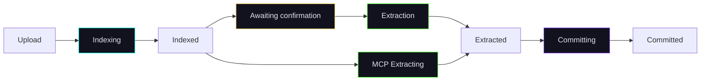

import Tabs from '@theme/Tabs';
import TabItem from '@theme/TabItem';

# Sources

Sources are the foundation of Chaos Cypher. A source is any document — PDF, Word file, web page, image, audio, or video — that you import into the system for indexing, search, and knowledge extraction.

:::note[API port]

The `curl` examples on this page use `http://localhost:8080`, which is the API port for the multi-container development stack. The all-in-one container (the primary install) serves the API on port **80** instead — use `http://localhost/api/v1/...` there.

:::

## Uploading Sources

### Single File Upload

<Tabs>
<TabItem value="web-ui" label="Web UI">


1. Navigate to **Sources** in the sidebar
2. Click **Add Source** to open the Add Source dialog, then drag and drop your file into the drop area or click to browse
3. The file enters the processing pipeline automatically


</TabItem>
<TabItem value="cli" label="CLI">


```bash
chaoscypher source add document.pdf
```

The CLI runs the full pipeline (upload → index → extract → commit) with a progress bar for each stage; by default it pauses after indexing to let you confirm the auto-detected extraction domain (skip with `--no-confirm`).

</TabItem>
<TabItem value="python" label="Python">


```python
from chaoscypher_core import ChaosCypher

result = ChaosCypher.add_document_sync("document.pdf")
print(f"Created {len(result.nodes)} nodes, {len(result.edges)} edges")
```

</TabItem>
<TabItem value="api" label="API">


```bash
curl -X POST http://localhost:8080/api/v1/sources \
  -F "file=@document.pdf"
```

</TabItem>
</Tabs>


### Batch Upload

<Tabs>
<TabItem value="web-ui" label="Web UI">


1. Click **Add Source** on the Sources page
2. In the Add Source dialog, select multiple files (up to 20 per batch) or drag and drop them into the drop area


</TabItem>
<TabItem value="cli" label="CLI">


```bash
# Multiple files
chaoscypher source add doc1.pdf doc2.txt notes.md

# Entire directory (all supported files)
chaoscypher source add ./research-papers/
```

</TabItem>
<TabItem value="python" label="Python">


```python
from chaoscypher_core import ChaosCypher

files = ["doc1.pdf", "doc2.pdf", "doc3.txt"]
for f in files:
    result = ChaosCypher.add_document_sync(f)
    print(f"{f}: {len(result.nodes)} nodes")
```

</TabItem>
<TabItem value="api" label="API">


```bash
curl -X POST http://localhost:8080/api/v1/sources/batch \
  -F "files=@doc1.pdf" \
  -F "files=@doc2.pdf" \
  -F "files=@doc3.txt"
```

</TabItem>
</Tabs>


### URL Import

<Tabs>
<TabItem value="web-ui" label="Web UI">


1. Click **Add Source** on the Sources page
2. In the Add Source dialog, paste the URL of a web page into the **URL** field (above the file drop area) and confirm
3. The system fetches the page, extracts clean text content, and processes it like any other source

</TabItem>
<TabItem value="cli" label="CLI">


```bash
chaoscypher source add https://example.com/article
```

</TabItem>
<TabItem value="python" label="Python">


```python
from chaoscypher_core import ChaosCypher

result = ChaosCypher.add_document_sync("https://example.com/article")
print(f"Created {len(result.nodes)} nodes")
```

</TabItem>
<TabItem value="api" label="API">


```bash
curl -X POST http://localhost:8080/api/v1/sources/url \
  -H "Content-Type: application/json" \
  -d '{"url": "https://example.com/article"}'
```

</TabItem>
</Tabs>


The system fetches the page, extracts clean text content, and processes it like any other source. URLs must be HTTP/HTTPS and the extracted content must be at least 50 characters.

To import every page of a documentation site at once, see [Import a Docs Site](site-import.md).

### Supported File Types

| Category | Formats |
|----------|---------|
| **Documents** | PDF, DOCX (Word), EPUB |
| **Office** | XLSX (Excel), PPTX (PowerPoint) |
| **Text** | Plain text (.txt), Markdown (.md), Log files (.log) |
| **Web / Markup** | HTML (.html / .htm / .xhtml), reStructuredText (.rst) |
| **Data** | CSV, JSON, JSONL, NDJSON |
| **Images** | JPEG, PNG, GIF, WebP, TIFF, BMP (described by the vision LLM) |
| **Audio** | MP3, WAV, M4A, FLAC, OGG, WMA, AAC (transcribed to text) |
| **Video** | MP4, MKV, AVI, MOV, WebM, WMV, FLV (audio extracted and transcribed) |
| **Archives** | ZIP, TAR.GZ / TGZ (files extracted and processed individually) |

The complete list of extensions each loader accepts is in [Loaders](loaders.md).

:::info[File size limit]

The default per-file upload cap is **5 GB** (`batching.max_upload_bytes`). Upload routes are exempted from the per-route 128 MB outer body cap (`batching.max_request_body_mb`) and gated by `max_upload_bytes` only. To raise the cap, set `batching.max_upload_bytes` in `settings.yaml` — nginx's `client_max_body_size` (including on the internal auth-check subrequest) is rendered from this value at container start, so a single source of truth governs both layers.

:::

:::info[Archive handling]

Archives are automatically extracted and the system detects the documentation format — Sphinx HTML, Markdown docs (MkDocs, Docusaurus), OpenAPI specs, or mixed files. Each file is processed according to its detected type.

:::

## Vision Processing

When `enable_vision` is enabled during upload, images embedded in PDFs and standalone image files are processed with the configured vision model. The vision model generates textual descriptions of visual content — diagrams, charts, photographs, and other images — which are included in the document chunks. This improves search and RAG quality by making visual content discoverable through text queries.

Vision processing is optional and requires a vision model to be configured in **Settings** > **Models**. For sources processed with vision enabled, the page images are shown on the source detail **Chunks** tab (a per-chunk thumbnail strip and a page-images section), each alongside its generated description.

The choice you make at upload time is persisted on the source row, so re-extract and recovery honor it without you having to re-pass the flag.

## Upload settings are persistent

Every choice you make on the upload dialog is stored on the source row, not on the in-flight queue payload. That means:

- **Recovery** after a worker restart re-reads your settings instead of resetting everything to defaults.
- **Retry** an errored source preserves your normalization, vision, and content-filtering choices.
- **Re-extract** runs the new extraction with the same settings the source was uploaded with — unless you explicitly override one for the re-extract call.

The persisted fields are:

| Field | What it controls |
|------|------------------|
| `auto_analyze` | Whether the upload flow auto-queues entity extraction after indexing. |
| `enable_normalization` | Run the cleaner pipeline (encoding fixes, OCR cleanup, paragraph dedup). `null` means "use the file-type default." |
| `enable_vision` | Use the vision model on images and scanned PDFs. |
| `content_filtering` | Apply domain content-exclusion rules during extraction. Filtered text stays searchable via RAG. |
| `filtering_mode` | Strictness of post-extraction filters: `unfiltered` / `minimal` / `lenient` / `balanced` / `strict` / `maximum`. See [Filtering Modes](../reference/filtering-modes.md). |

## Processing Pipeline

Every source goes through a multi-stage pipeline. The first stage (indexing) runs automatically. The second stage (extraction) is optional and uses AI.



### Stage 1: Indexing

Runs automatically after upload. The document is chunked into segments and each chunk is embedded as a vector for semantic search.

| What happens | Output |
|-------------|--------|
| Text extraction from source format | Raw text content |
| Content normalization (optional) | Clean, consistent text |
| Chunking into segments | Configurable size (default ~900 chars) |
| Vector embedding generation | One embedding per chunk |

**Time:** ~30 seconds for a 100-page PDF.

After indexing, the source is searchable via RAG — you can chat about it and search it immediately, without waiting for extraction.

### Confirm the Extraction Packs

By default, extraction doesn't start until you confirm the packs detection proposed (see [extraction domains](domains.md)): every source extracts with the floor — the core entity types and relationships — plus the packs you keep. After indexing, an auto-detected source parks at `awaiting_confirmation` (phase `awaiting_input`) — it's already searchable via RAG while it waits.

- **Web UI** — a confirmation dialog shows the proposed packs as chips, pre-selected; add or remove packs (no chip is the floor alone) and confirm to start extraction. Later, **Change packs…** in the source page's actions menu re-extracts the source under other packs.
- **CLI** — `chaoscypher source add` prompts interactively ("Confirm extraction domain") when run in a terminal. Non-interactive or quiet runs park the source instead; confirm it later with `chaoscypher source confirm <SOURCE_ID>`, or pass `--no-confirm` to accept the auto-detected domain and skip the gate.
- **API** — confirm a parked source with `POST /api/v1/sources/{source_id}/confirmation`, or bypass the gate at upload time with the `auto_confirm=true` form field (default `false`).

Choosing the packs at upload (the dialog's chips with *Detect packs automatically* off, the `packs` field, or the `--pack` flag) skips the gate entirely — there is nothing to confirm.

### Stage 2: Entity Extraction (Optional)

Uses an LLM to extract entities (people, organizations, concepts, etc.) and relationships from each chunk.

| What happens | Output |
|-------------|--------|
| Chunk groups sent to LLM | Entity + relationship extraction |
| Template matching | Consistent entity types |
| Deduplication | Merged duplicate entities |
| Relationship mapping | Connections between entities |
| Entity embeddings | Vector embeddings for graph entities |

**Time:** ~5 minutes for a 100-page PDF (depends on LLM speed).

**Controls:**

- **Extraction depth** — `full` (comprehensive, default) or `quick` (faster, fewer entities)
- **Packs** — detected automatically (you confirm the picks) or chosen by hand; every source gets the floor, see [Domains](domains.md)
- **Cancel** — Extraction can be cancelled mid-process. Completed chunks are preserved and the source reverts to `indexed` status (RAG still works).

### Stage 3: Committing

Automatically runs after extraction. Imports extracted entities and relationships into the knowledge graph.

| What happens | Output |
|-------------|--------|
| Create graph nodes | One node per entity |
| Create graph edges | One edge per relationship |
| Create templates | Node type templates for the graph |
| Link to source | Document node with provenance |

### Status Flow

Every source exposes a `progress` object with a 5-phase summary designed for the UI:

| Phase | Searchable | Meaning |
|-------|:----------:|---------|
| `waiting_to_index` | No | Pending or failed — nothing useful exists yet |
| `indexing` | No | Chunking and embedding in progress |
| `awaiting_input` | **Yes** | Indexed and searchable; waiting for you to confirm the auto-detected extraction domain |
| `extracting` | **Yes** | Indexed and searchable; extraction is optional and may be running |
| `ready` | **Yes** | Fully committed to the knowledge graph |

The `is_searchable` flag in `progress` lets the UI immediately determine whether the source can be queried, without parsing individual status strings.

<details>
<summary>Internal status values (for debugging and API consumers)</summary>

| Status | Maps to | Meaning |
|--------|---------|---------|
| `pending` | `waiting_to_index` | Uploaded, waiting to start |
| `indexing` | `indexing` | Chunking and embedding in progress |
| `vision_pending` | `indexing` | Waiting for vision processing of images |
| `indexed` | `extracting` | Searchable via RAG, ready for extraction |
| `awaiting_confirmation` | `awaiting_input` | Searchable via RAG; parked for domain confirmation before extraction |
| `extracting` | `extracting` | LLM entity extraction in progress |
| `mcp_extracting` | `extracting` | [Model Context Protocol](https://modelcontextprotocol.io/) (MCP)-driven entity extraction in progress |
| `extracted` | `extracting` | Extraction complete, ready to commit |
| `committing` | `extracting` | Importing entities into knowledge graph |
| `committed` | `ready` | Fully processed |
| `error` | `waiting_to_index` | Failed at some stage (check `error_message`) |

</details>

:::tip

A source at `indexed` status is already useful — you can search it and chat about it. Extraction adds the knowledge graph layer on top.

:::

:::info[Technical deep-dive]

For detailed architecture of each pipeline stage, see the [Extraction Pipeline Architecture](../architecture/extraction-pipeline/overview.md).

:::

## See also

- [Architecture: Extraction Pipeline](../architecture/extraction-pipeline/overview.md) — detailed pipeline stages, queue routing, error handling, and content filtering internals
- [API reference: Sources](../reference/api/sources.md) — full endpoint reference for upload, extraction management, chunks, citations, and tags

## Tags

Tags group documents: `research`, `project:alpha`, `q3_notes`. Each tag has a name, an optional colour and an optional description, and each database has its own set of tags.

**The tag rule.** One rule holds everywhere a tag is given: the web UI, the API, the CLI, MCP and package import.

- A tag is trimmed and lower-cased first, so `Research` and ` research ` are the tag `research`.
- After that it must use only `a-z`, `0-9`, `:`, `_` and `-`, start with a letter or digit, and be at most 64 characters long. A tag that does not fit is refused, never quietly changed: `tag "Work Docs" is not allowed: use a-z, 0-9, ':', '_' or '-', starting with a letter or digit, at most 64 characters`.
- A document carries at most 32 tags. A change that would give it more is refused, and nothing is changed: `a document can carry at most 32 tags; this would give it 33`.
- The same tag given twice counts once.

**Adding a document again.** Tags given when you add a document that is already there (a skipped duplicate, an MCP re-add) are **added to** its tags. To make them the whole list, use `replace_tags` (MCP) or edit the tags directly (`chaoscypher source tag … --replace`, `PATCH /api/v1/sources/{id}/tags`).

**Imported packages.** A package's keywords become the document's tags. A keyword the rule refuses is skipped with a warning in the import's result, as are keywords past the 32 cap.

**Tags from before 0.7.0.** Migration `0026` renames every existing tag to fit the rule: it lower-cases the name and turns each run of other characters into one `-` (`Work Docs` becomes `work-docs`). Tags that then share a name are merged into the oldest one, which keeps its colour. When it would change any tag, the migration waits for your confirmation and lists every rename and merge first: run `chaoscypher db migrate status` to see them, then apply it from the upgrade page or with `chaoscypher db migrate apply` (MCP clients see the same list in `upgrade_status`). A database whose tags already fit the rule upgrades without asking.

<Tabs>
<TabItem value="web-ui" label="Web UI">


- Create, assign and remove tags from a committed source's detail page header (the tag editor next to the title). A refused tag shows the rule's message.
- Filter the sources list by tags; with two or more tags chosen, choose whether a source must carry **any** of them or **all** of them.


</TabItem>
<TabItem value="cli" label="CLI">


```bash
# Tag a document as you add it (repeat --tag)
chaoscypher source add report.pdf --tag research --tag project:alpha

# Add, remove, replace or clear a document's tags
chaoscypher source tag <source_id> --add q3 --remove draft
chaoscypher source tag <source_id> --replace research
chaoscypher source tag <source_id> --clear

# List or search only the documents carrying a tag
chaoscypher source list --tag research --tag project:alpha --match all
chaoscypher source search "budget" --tag research

# Chat scoped to sources with a specific tag
chaoscypher chat -t "research" "Summarize the findings"
```

See [`source tag`](../reference/cli/sources.md#source-tag) for every option.

</TabItem>
<TabItem value="api" label="API">


```bash
# Upload with tags (repeat the form field) and a summary
curl -X POST http://localhost:8080/api/v1/sources \
  -F "file=@report.pdf" -F "tags=research" -F "tags=project:alpha" \
  -F "summary=Quarterly research report."

# Add and remove tags by name
curl -X PATCH http://localhost:8080/api/v1/sources/{source_id}/tags \
  -H "Content-Type: application/json" \
  -d '{"add": ["q3"], "remove": ["draft"]}'

# List the sources carrying both tags
curl "http://localhost:8080/api/v1/sources?tags=research&tags=project:alpha&match=all"
```

See [Sources API — tags](../reference/api/sources.md#edit-a-sources-tags-by-name).

</TabItem>
</Tabs>

**Searching inside a tag set.** `source search --tag`, MCP `search_chunks`, `graphrag_search` and `list_documents` with `tags`, and the API's `?tags=` filter apply the tags inside the search itself, before the result limit, so a scoped search returns a full page of matches from those documents. `match` is `any` (the default) or `all`. A tag set that no document carries returns nothing; it never falls back to searching everything. MCP `search_chunks` and `graphrag_search` tag scopes are strict: chunks come only from the tagged documents, and so does `graphrag_search`'s graph: an entity you made by hand, one no document backs, or a relationship only an untagged document states is left out (a source scope, by contrast, keeps them). Chat's tag scoping (`chaoscypher chat --tag`, the API's `tag_ids`) is a lens: it adds the tagged documents to the chat's sources and keeps the source scope's rule (see [Chat — Tag Scoping](chat.md#tag-scoping)).

### Summaries

Each document can carry a one-line summary, shown under its title in the sources list, in `source list`, in MCP `list_documents` and in the API's source responses.

- **Written at import.** When a model is configured, the document's summary is written by that model once the document is indexed: one call, limited to `source_processing.import_summary_timeout_seconds` (60 s by default), never retried. If the call fails or times out, the document is indexed as usual and simply has no summary; no placeholder text is ever stored. With no model configured, no summary is written.
- **Your own.** A summary you give (`--summary` on `source add`, `summary` on the upload, `PATCH /sources/{id}` or MCP `add_document`/`tag_document`) is used instead, and the model is not asked. A summary given again replaces the old one; leaving it out keeps it; `""` clears it. A summary longer than `source_processing.summary_max_chars` (300 by default) is refused.
- **The switch.** `source_processing.import_summaries: false` turns import-time summaries off.
- **Backfill.** `chaoscypher source summarize --missing` writes a summary for every indexed document that lacks one; without `--missing` it rewrites every summary, including ones you typed. See [`source summarize`](../reference/cli/sources.md#source-summarize).
- **Packages.** Exports carry the summary as the document's `abstract`. Importing a package never calls a model. On a re-import, a document takes its title and summary from the package again, replacing a local edit, so edit them at the package's origin; a package without an abstract keeps the local summary.

## Content Filtering

Content filtering removes non-essential content — table of contents, changelogs, legal boilerplate, bibliography sections, and similar noise — before entity extraction. This improves extraction quality by focusing the LLM on meaningful content and reducing token waste.

**Key points:**

- Enabled by default on all uploads (`content_filtering=true`)
- Filtered content is **only removed from extraction** — it remains fully searchable via RAG
- Each [extraction domain](domains.md) defines which content categories to exclude
- 15 built-in categories cover common non-essential patterns (TOC, legal, boilerplate, etc.)
- Domains can also define custom regex patterns for domain-specific filtering

To disable content filtering for a specific upload (e.g., when the "boilerplate" content is actually important):

<Tabs>
<TabItem value="web-ui" label="Web UI">


Uncheck **Content Filtering** in the upload dialog.

</TabItem>
<TabItem value="api" label="API">


```bash
curl -X POST http://localhost:8080/api/v1/sources \
  -F "file=@document.pdf" \
  -F "content_filtering=false"
```

</TabItem>
</Tabs>


:::info[Technical deep-dive]

For details on the filtering pipeline, categories, and custom patterns, see the [Content Filtering](../architecture/extraction-pipeline/overview.md#content-filtering) section in the Extraction Pipeline Architecture.

:::

## Content Normalization

Uploaded content is normalized to fix common issues:

- Encoding fixes (UTF-8 normalization)
- Whitespace normalization (consistent line breaks, trimmed excess)
- OCR artifact cleanup

Normalization defaults off for `.csv`, `.tsv`, `.json`, `.jsonl`, `.ndjson`, `.xml`. You can override per-upload.

To override the default for a specific file:

```bash
# Force normalization on for a CSV
curl -X POST http://localhost:8080/api/v1/sources \
  -F "file=@data.csv" \
  -F "enable_normalization=true"

# Force normalization off for a PDF
curl -X POST http://localhost:8080/api/v1/sources \
  -F "file=@report.pdf" \
  -F "enable_normalization=false"
```

## Duplicate Detection

When uploading with `skip_duplicates=true`, the system computes a SHA-256 hash of the file content and skips files that already exist in the database. This prevents accidentally importing the same document twice.

## Managing Sources

### Enable/Disable

Toggle a source's `enabled` flag to include or exclude it from:

- Knowledge graph visibility
- AI chat context
- Search results

<Tabs>
<TabItem value="web-ui" label="Web UI">


Choose **Disable** (or **Enable**) in a source's action menu (the ⋮ button on its row in the Sources list).


</TabItem>
<TabItem value="cli" label="CLI">


Source enable/disable is managed via the API or Web UI.

</TabItem>
<TabItem value="api" label="API">


```bash
curl -X PATCH http://localhost:8080/api/v1/sources/{source_id} \
  -H "Content-Type: application/json" \
  -d '{"enabled": false}'
```

</TabItem>
</Tabs>


Disabling a source doesn't delete it — the data is preserved and can be re-enabled at any time.

An entity that two sources both mention can be merged into one node in the knowledge graph. A merged entity stays visible while any of its sources is enabled; disabling one of them hides only what that source alone contributed.

### Deletion

Deleting a source permanently removes:

- The source file record
- All document chunks and embeddings
- Associated citations
- Extraction job data
- The entities and relationships only this source mentions

Content another source also mentions is kept. An entity or relationship merged from several sources stays in the graph and is rebuilt from the sources that remain: its name, aliases and description become what those sources say, with nothing left from the deleted one. Re-committing or re-extracting a source works the same way: its previous contribution is taken out, other sources' content stays, and the new commit merges back in.

<Tabs>
<TabItem value="web-ui" label="Web UI">


Click the delete button on a source and confirm the deletion.

</TabItem>
<TabItem value="cli" label="CLI">


```bash
# Delete with confirmation prompt
chaoscypher source delete SOURCE_ID

# Skip confirmation
chaoscypher source delete SOURCE_ID --force
```

</TabItem>
<TabItem value="api" label="API">


```bash
curl -X DELETE http://localhost:8080/api/v1/sources/{source_id}
```

</TabItem>
</Tabs>


:::warning

Deletion is permanent and cannot be undone. Graph entities cited only by this source are deleted along with it (and removed from the search index); entities also cited by other sources remain in the knowledge graph.

:::

### Abort Processing

If a source is stuck or you need to stop processing:

- **Cancel extraction** — Stops entity extraction, preserves completed chunks, reverts to `indexed`
- **Abort all processing** — Cancels any in-progress stage and marks the source with an error

## Monitoring Extraction

For detailed extraction monitoring, you can view:

- **Task list** — Individual chunk extraction tasks with status, timing, and entity counts
- **Stats** — Aggregate statistics (average tokens, duration, entities per chunk)
- **Charts** — Visual progress data for the extraction pipeline

<Tabs>
<TabItem value="web-ui" label="Web UI">


Open a source's detail view to see extraction progress, task breakdown, and statistics.


</TabItem>
<TabItem value="cli" label="CLI">


```bash
# View source details including extraction status
chaoscypher source get SOURCE_ID
```

</TabItem>
<TabItem value="api" label="API">


```bash
curl http://localhost:8080/api/v1/sources/{source_id}
```

</TabItem>
</Tabs>
